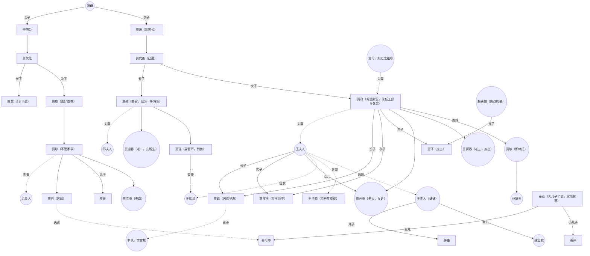

# 红楼梦

## 前言

采用**人民文学出版社**版本，即乾隆二十五年的**庚辰本**。

《红楼梦》在乾隆中叶以后，尤其是**脂砚斋**[^a]点评版本的抄本诸多，价格昂贵至数十金一部。今传乾隆时期的《红楼梦》抄本就有十多种：

- 己卯本（怡亲王府抄本，约1760年抄成）
- 庚辰本（约1761年抄成）
- 甲戌本（约1754年抄成，但现存版本又是更晚的改动版本）
- 《红楼梦》稿本
- 蒙古王府本（蒙府本）
- 戚蓼生序本（戚序本）
- 戚蓼生序南京图书馆藏本
- 梦觉主人序本（1784年抄成，又称甲辰本）
- 舒元炜序本（1789年抄成，又称舒序本）
- 郑振铎藏本
- 苏联列宁格勒亚洲图书馆藏本
- 《卞藏脂本红楼梦》（又称卞藏本）
- 程伟元初排活字本（1791年抄成，又称程甲本）
- 程伟元二排活字本（1792年抄成，又称程乙本）

庚辰本是抄得较早而又比较完整的唯一的一种，它虽然存在着少量的残缺，但却保存了原稿的面貌，未经后人修饰增补，所以使用这一版本作为底本，其他版本作为参考。

曹雪芹，字号有两种说法。据曹雪芹的好友张宜泉的说法，曹雪芹，名霑，字梦阮，号”芹溪居士“；另一说是字芹圃，号”雪芹“。

书的前八十回确由曹雪芹所著，后四十回据专家研究，认为基本上已经完成，但是由于某些未知原因而没有抄本传于世，最终迷失。现今的后四十回采用程甲本为底本，作者不详，只知道程伟元、高鹗为整理刊行者。虽然现今版本的后四十回思想艺术上远不及前八十回曹雪芹原著，但已是多个版本的后四十回续中最好的一版了。

据第一回所述，《红楼梦》又名《石头记》、《情僧录》、《风月宝鉴》。“石头记”过于宽泛而不能概括内容；“情僧录”、“风月宝鉴”又着重于书中的”情“而略去了书中的家族衰亡；第五回中提到”红楼梦“是十二支曲的总题，这十二支曲以贾宝玉和金陵十二钗的命运概括了书中的爱情悲剧、命途多舛、家道中落，作为书籍标题最为合适，故选之。

[^a]: 脂砚斋在第五回的批注中提到”命芹溪删去“，可能说明脂砚斋是曹雪芹的长辈，但真实性存疑。
## 人物关系

## 情节摘要

### 第一回 甄士隐梦幻识通灵 贾雨村风尘怀闺秀

故事从哪里说起？原来当年女娲补天之时，炼了三万六千五百零一块石头，却有一块没有用上，丢弃在青埂峰下。这块石头为自己无用而日夜哀叹。后来有一个僧人一个道士，劝慰石头，若能在石头上镌刻些字，便可到人间繁华处一游。

又过了很久，有个空空道人，在青埂峰见到了石头。彼时的石头上已经镌刻了一段趣味故事，这故事便是《石头记》。空空道人誊抄了这篇《石头记》，改名为《情僧录》，后人又题《风月宝鉴》[^1-1]。至于曹雪芹批阅《石头记》时，增删五次，历经十载，又题名《金陵十二钗》，并题一绝云：

> 满纸荒唐言，一把辛酸泪。都云作者痴，谁解其中味！

《石头记》记录的是怎样的故事？

话说当时姑苏城[^1-2]闾门外十里街仁清巷[^1-3]内有座古庙名为“葫芦庙”，隔壁住着一户乡宦，叫甄费字士隐[^1-4]。他性情淡泊功名，以吟诗酌酒为乐，只有一个独生女。

某天，**甄士隐**读书疲倦，睡梦中梦见一个僧人一个道士在对谈。提到当年有块石头不被女娲所用，被留在天上，滋养了一株绛珠仙草。后来绛珠仙草修炼成人，想要报答石头，说到若有一日她和石头一起投胎人间，她愿把一生眼泪还给石头作为报答。甄士隐上前询问，原来那石头是块通灵宝玉。今日那仙草和石头就要随一干情鬼投胎人间。僧人夺回那块宝玉，和道士进了一大石牌坊，名曰“**太虚幻境**”。两边有一副对联

> 假作真时真亦假，无为有处有还无

甄士隐也想跟随进去，却突然感知山崩地裂，惊醒过来。

葫芦庙中住着一个穷书生，叫做贾化字时飞号雨村[^1-5]。他这一系只剩下他一根独苗，每日只靠书法维持生计。甄士隐邀请**贾雨村**到他府上做客。席上贾雨村看见一个丫鬟不时看他，于是把丫鬟视作了知己。

到了中秋，甄士隐又来邀请贾雨村到府上酌酒。甄士隐赞叹贾雨村的文才，得知他盘缠不够不得入都考试，自愿资助他入都。后来，甄士隐接连遭遇了女儿走失、房屋被牵连烧毁、田地荒芜、世态炎凉，最后只得投奔岳丈家中，又被岳丈看不起，心中郁闷。一日出门，见到一位跛足道士，谈话情投意合，于是甄士隐直接接过道士的褡裢，和道士一起云游离去。

[^1-1]: 《风月宝鉴》—— 甲戌本有两个版本的批注：全篇批注中说《红楼梦》又叫《风月宝鉴》；此回批注中说《风月宝鉴》是曹雪芹曾经写过的一部书，由他的弟弟棠村作序。
[^1-2]: 姑苏城，即今日苏州城。
[^1-3]: 脂批：十里街谐音“势利街”，仁清巷谐音“人情巷”。
[^1-4]: 甄士隐：脂评，谐音“真事隐”。
[^1-5]: 贾雨村：脂评，谐音“假语存”。
### 第二回 贾夫人仙逝扬州城 冷子兴演说荣国府

贾雨村发迹之后，做了甄士隐岳丈所在县的新一任知府。他刚好看到了在街上看到了那个曾经在甄士隐府上的丫鬟，认定甄士隐移居至此，于是顺藤摸瓜找到了甄士隐的岳丈家。岳丈将甄士隐云游和他女儿走失的事情告诉了贾雨村。贾雨村又点名，纳了那个丫鬟作二房夫人。贾雨村任了县知府后，因为性格侍才侮上又难免贪污小钱，后来被其他官员抓住机会穿了小鞋革职了。

后来贾雨村游历到扬州地带。此地的御史名为林海字如海，袭列侯至此已五世，略有地位，书香门第，但不幸门丁不旺，只有嫡妻贾夫人留下一女，名为**林黛玉**，此时五岁。**林如海**夫妻二人因为只有这一个孩子，黛玉又天性聪颖，甚是疼爱，教她读书。

贾雨村出游盘缠将尽，便托了关系进了林如海府上，担任了林黛玉的老师，维持生计。一年后，黛玉的母亲病逝。黛玉本就身体虚弱，又遭遇母亲病逝万分悲痛，于是多日不上学，反倒让贾雨村闲居无聊。

这天贾雨村到酒肆，意外遇到做古董贸易的老友**冷子兴**。冷子兴介绍到贾雨村的同姓旁族宁国和荣国贾家今天已经家道中落，外表还能保持光鲜亮丽，内部已经衰落。宁国府和荣国府正好在一条街的东西两侧且相连，府宅占了大半条街。

下面是冷子兴介绍了两家的人物关系，我用 #关系图 来标注：

一些丫鬟、小厮等名称的补充：

- 茗烟：宝玉的书童
- 李嬷嬷：宝玉的奶妈
- 袭人：宝玉身边最重要的丫鬟，对宝玉极为忠诚。
- 晴雯：宝玉的丫鬟
- 麝月：宝玉的丫鬟
- 花自芳：袭人的哥哥
- 香菱：薛蟠买的丫鬟，甄士隐走失的女儿
- 莺儿：薛宝钗的丫鬟

贾宝玉好女人首饰。贾政便嫌弃他是酒色之徒，但太夫人还疼爱曾孙。冷子兴说他后来一定是酒色之徒，而贾雨村却说他是汇集大仁大恶之气的神人。

### 第三回 贾雨村夤缘复旧职 林黛玉抛父进京都

林如海为贾雨村作了举荐信，把贾雨村举荐到荣国府。荣国府祖母念及林黛玉孤身伴父，也请林黛玉寄居荣国府。贾政礼贤下士，对贾雨村颇有好感，后来替贾雨村谋了个岗位。

林黛玉到了都城，便感觉到此地气派不凡，处处谨言慎行。到了荣国府，祖母贾母（姓史）抱着外孙女哭泣。林黛玉和几个舅妈表姐妹打过招呼，她们见黛玉体弱多病，问到治病。林黛玉回，三岁时曾遇到个癞头和尚要带她出家，父母不肯，和尚便说恐怕她要一生体弱多病了。若要平安健康，除了父母不得见任何外亲。黛玉一家并不信。

随后林黛玉表哥贾琏的妻子，性格火辣的**王熙凤**见了林黛玉。林黛玉的二舅妈，贾政的妻子**王夫人**带着她先是见了林黛玉的大舅妈，贾赦的妻子**邢夫人**；又到了舅舅贾政府上。王夫人告知林黛玉她的二儿子，黛玉的表哥贾宝玉是家里的“混世魔王”，可不要搭理他。

晚间黛玉和几个舅妈、表妹在贾母后院吃了饭，正好遇到了贾宝玉回家。贾宝玉对林黛玉格外亲近，问到可有宝玉？林黛玉说不曾有，引得贾宝玉伤心摔玉。贾母视外孙天生口衔这玉为命根子，极为心疼，便唬骗贾宝玉林黛玉也是有宝玉的，不过是黛玉母亲去世时陪同下葬了。

林黛玉来荣国府带了奶娘**王嬷嬷**和一个随身的小丫头**雪雁**。贾母把自己身边的一个丫头“**鹦哥**”分配给林黛玉，又给分配了几个嬷嬷和丫鬟。贾宝玉的奶娘是**李嬷嬷**，大丫鬟名为**袭人**。袭人本是贾母的婢，贾母甚是喜欢和信任袭人，就把袭人配给贾宝玉做丫鬟。袭人有个痴情之处，眼中只有主子一个，全心全意伺候。

### 第四回 薄命女偏逢薄命郎 葫芦[^4-1]僧乱判葫芦案

第二天，林黛玉和姊妹们到了王夫人处，王夫人正在计议家务。原来，林黛玉的姨妈薛夫人的儿子**薛蟠**仗势欺人打死人命正在受审。审案的人正是贾雨村。贾雨村本要直接派人捉拿薛蟠，案边的一个门子，曾经在葫芦庙住过的，认识贾雨村，拦住了他。门子告诉贾雨村本地有**贾史王薛**四大乡绅是不可得罪之人。门子又介绍到这个人命案：被打死之人是本地一个小乡绅之子名为冯渊，先从人口拐卖贩子处买得一个丫头；不料人口拐卖贩子又悄悄把丫头卖给薛蟠，想赚两边钱跑路而不得。二人先把人口贩子揍个半死，后薛蟠仗势欺人又打死了冯渊。更巧的是，这拐卖的丫头，正是昔日甄士隐唯一的女儿英莲。

贾雨村本想依照法理断案。但门子说到薛家不可得罪，大道理在现实行不得。如果得罪薛家，不但没机会升官进爵，很可能自身难保。门子建议贾雨村表面上遣人捉拿薛蟠，实则谎报薛蟠暴病身亡，让薛家赔偿一千两做葬礼钱就了事。贾雨村就照这个方案执行了。

却说薛蟠是个不懂家庭经营的纨绔子弟。父亲早逝，母亲是贾政的妻子王夫人的妹妹，又有舅舅**王子腾**现任京营节度使。薛蟠的妹妹名为**薛宝钗**，有读书写字的天分，但哥哥不争气，便只做家事为母亲分担。近日，皇帝崇尚诗文礼仪，又碰上京都中生意被害，薛蟠为了送妹妹进京举荐、管理京都生意，收拾东西上京城。起身前就遇到了这个人贩子在卖英莲。

薛蟠带着母亲和妹妹入京，恰好舅舅王子腾升了职调任到京都外，于是三人借住了荣国府，薛蟠受了贾家看管。薛宝钗行为豁达，相比孤高自许的林黛玉，更得下人丫鬟们欢心。

[^4-1]: 葫芦：一语双关，既用贾雨村曾经住过的葫芦庙，又用来谐音“糊涂”，隐喻后文草草断案。

### 第五回 游幻境指迷十二钗 饮仙醪曲演红楼梦[^5-1]

这天，宁府梅花盛开，于是贾珍的妻子尤夫人邀请了贾母和一干夫人饮酒赏花。中间贾宝玉犯困，贾蓉的妻子秦夫人便安排他到书房休息。宝玉不喜欢书房的勤勉氛围，于是秦夫人又安排他到自己房间休息。[^5-2]

> 世事洞明皆学问，人情练达即文章。

宝玉睡着，却以为秦夫人还在前面，于是梦中自己跟随秦夫人到了个人迹罕至的山林中，见到了一个极为美丽的仙姑。仙姑称自己号为“警幻仙姑”，负责“掌管人间风情月债、尘世男女痴怨”，邀请她到自己的“**太虚幻境**”喝茶饮酒。宝玉被仙姑吸引，忘了秦夫人，进了太虚幻境。宝玉求着仙姑带他游览“薄命司”，看到一间房屋用封条封上，封条上写着“金陵十二钗正册”。仙姑说“金陵十二钗正册”只记载各省中十二个最主要的女子，另有次要的女子记录在《金陵十二钗副册》，再次要的记录在《金陵十二钗又副册》。说是女子，实际上只画着景观题了诗[^5-3][^5-4]，并没有指名道姓是哪个人，贾宝玉一时看不懂参不透这本册子。

> 假作真时真亦假，无为有处有还无。

仙姑知道贾宝玉天分聪颖，怕他参透册子泄露天机，就把他带到了幻境之内，又上来几个仙子。仙子嗔怪警幻仙姑，怎么带来个男儿身浊物到此清净女儿之境。警幻仙姑称自己遇到了宁荣二公之灵，嘱托她引导贾宝玉能戒痴情顽劣、跳出宿命、走上正途。而那“金陵十二钗”之册，其实正是宁荣二家上中下三等女子的记录。随后警幻仙姑请宝玉品仙茶饮仙酒，看得舞女和《红楼梦》十二只曲跳舞。[^5-5]宝玉只觉无趣，警幻感叹“痴儿尚未领悟”。又带宝玉到了一间闺房中，早有一名女子在内，警幻说她是自己的妹妹，乳名兼美字**可卿**。警幻仙姑称将可卿许配给宝玉，秘授宝玉以云雨之事，于是贾宝玉和可卿玩得难解难分。第二日，二人出去游玩，见得虎狼成群，有水鬼拖宝玉下去，弄得宝玉惊醒。门外秦夫人听得宝玉梦话纳闷，原来那“可卿”正是她小名，而她从来没对外提过。

[^5-1]: 这一回的玄幻部分蕴含了很多内容，非简单概括可以描述。
[^5-2]: 这一段秦夫人的房间的装饰充满了对男女淫乱、女色的暗示，概括剧情时被我省略。
[^5-3]: 这边的景观图和诗暗示了金陵十二钗的经历与结局，概括剧情时被我省略。
[^5-4]: 秦可卿的判词其实是批判她淫乱的。据脂砚斋批注，小说第十三回回目原名“秦可卿淫丧天香楼”，但脂砚斋为秦可卿魂托凤姐贾家后事二件而感动，饶恕了秦的错误，命曹雪芹删去了秦淫乱的情节。虽然这部分情节被删除，但是曹雪芹仍然保留了判词、画、房间装饰描写中关于初稿里秦可卿结局的某些暗示。
[^5-5]: 《红楼梦》十二支曲中《好事终》一曲暗示了秦可卿本来的结局是在天香楼悬梁自缢，但现存文稿改为秦可卿是病逝，没有详细交代。
### 第六回 贾宝玉初试云雨情 刘姥姥一进荣国府

宝玉惊醒后，只有袭人察觉宝玉裤子上冷湿。于是贾宝玉把梦中故事说与袭人听，袭人听得又羞又笑。宝玉也喜欢袭人温柔娇媚，袭人也知道贾母把自己许配给宝玉，于是二人偷偷试了一番云雨之事。

京都千里之外，有个小小人家，其实和荣府有些关系。这家姓王，祖上做过一个小京官，结识了王夫人的父亲。因为王夫人家的权势，便允许他沾上亲故，认作侄儿。那个时候只有王夫人和王夫人的哥哥（王熙凤的父亲）在京都，知道有这一桩关系，其余人都不了解。如今小王氏祖上已逝，只有一个儿子名为王成，家道中落后搬出京都生活。最近王成病逝，只留下儿子狗儿。狗儿娶刘氏为妻，又有一子一女，儿子叫板儿，女儿叫青儿。刘氏的母亲便是**刘姥姥**。狗儿一家四口加上刘姥姥就在城外依靠种田过活，生活困窘。

刘姥姥建议狗儿去找荣府王家攀攀关系说不定能求到点好处。狗儿便想了法子，让刘姥姥带着儿子板儿进荣国府前先找陪房周瑞，这人和王成关系不错。周瑞的妻子看在曾经交情，答应帮忙求见王夫人，但也提前警告了现在掌管家务的已经不是王夫人而是王夫人的侄女王熙凤。于是趁着荣国府吃饭时候，刘姥姥随着周瑞家进了荣国府。周瑞妻子先和王熙凤的心腹丫头**平儿**通了气，交代了刘姥姥的来历，先把刘姥姥及板儿安置在客房。后来王熙凤下了楼，刘姥姥终于见了王熙凤。

王熙凤表面上热情地接待了刘姥姥。刘姥姥正要说明来意，王熙凤的侄子贾蓉来到府上，向王熙凤借一个玻璃屏风。刘姥姥说到自己家境艰苦，于是王熙凤且赏了二十两银子，刘姥姥喜出望外。

### 第七回 送宫花贾琏戏熙凤 宴宁府宝玉会秦钟

周瑞妻子送刘姥姥回去后，上来回王夫人话，得知王夫人正在和她妹妹（即薛蟠的母亲薛夫人）聊天，便往里间来，见到薛宝钗。周瑞妻子问到宝钗几日没见出去逛逛，薛宝钗说到自己的病又发作了。这病难治，唯有一个秃头和尚带来个秘方，此药叫做“冷香丸”，只不过药方条件极其苛刻，但确能缓解病症。

周瑞妻子见了王夫人，交代了刘姥姥的事，薛夫人便委托她把自己带来的花分给姐妹们。英莲被薛蟠买下作丫头，换了名“**香菱**“。周瑞妻子便把花依次分给了迎春、探春、惜春姐妹、王熙凤和林黛玉。黛玉彼时正和宝玉玩东西，宝玉帮忙问了花的由来和薛宝钗的近况。黛玉倒嗔了一句”别人挑剩下的花儿才留给了我“。

周瑞的女儿正好寻往贾府遇到母亲，说到她老公（周瑞女婿）前段时间吃酒吃多和人起了纷争，被人告了”来历不明“要被赶出京城，请母亲帮忙解难。原来周瑞的女婿正是冷子兴。

第二日，应贾珍之妻尤夫人和秦可卿邀请，王熙凤和贾宝玉进了宁府。贾蓉带出一个腼腆后生，他是秦可卿的小兄弟，名为”**秦钟**“。宝玉见秦钟人品出众，自卑自己空有富贵不得早结交他；秦钟见宝玉衣着华丽，自卑自己清贫不得结识宝玉。二人几句对话反倒结识起来。宝玉问到秦钟学习情况，原来二人刚好正在停学阶段，于是宝玉邀请秦钟一起到家中私塾读书。

夜晚，尤夫人秦夫人准备叫人送秦钟回家，恰逢叫来的人是**焦大**。焦大这人小的时候曾经救过太爷的命，仗着这份救命之恩在府中豪横怠慢。这晚焦大喝醉了连着贾蓉一起辱骂，贾蓉怒得让人绑了他拖到马圈里去。

### 第八回 比通灵金莺微露意 探宝钗黛玉半含酸

王熙凤和贾宝玉从宁府回家，替秦钟向贾母美言几句，得到贾母欢心。

两日后贾母等去看戏。待到贾母疲惫后，贾宝玉送贾母回家歇息，顺便拜访薛家探病薛宝钗。薛宝钗取下了贾宝玉所戴的美玉，鉴赏其上镌刻有字。宝钗的丫鬟莺儿笑着提到薛宝钗的项圈上也镌刻有字，和宝玉这玉上所写像是一对。于是宝玉也赏起薛宝钗的项圈。二人聊到一半，林黛玉也来探病了。黛玉笑着说自己来的不巧了没交错着时间来。正好是下雪天，三人在薛姨妈家吃茶。贾宝玉的奶妈李嬷嬷拦着宝玉不让他喝酒，但薛姨妈还是热情地助宝玉尽兴喝酒，宝玉酩酊大醉。

李嬷嬷回家换了衣服，让丫头们帮忙盯梢。林黛玉贾宝玉不等李嬷嬷回来就直接和丫头们告辞薛家。宝玉问到自己留着的豆腐皮包子和枫露茶，听丫鬟说到都给李嬷嬷吃了，宝玉怒而摔茶杯，大骂要赶走奶妈李嬷嬷。彼时装睡的袭人赶紧起身安抚宝玉，这才安宁。

次日，宝玉带着秦钟见了贾母，甚是讨贾母欢心。秦钟的父亲**秦业**听闻儿子有在贾家私塾读书的机会，非常喜悦。但是家境贫寒，硬是东拼西凑带了二十四两给秦钟，来到私塾老师**贾代儒**家拜见了。

### 第九回 恋风流情友入家塾 起嫌疑顽童闹学堂

两天后，宝玉和秦钟去私塾上学了，二人关系甚好。私塾中本族子弟人多眼杂，看了宝玉和秦钟人腼腆关系又好，流言闲言遍布校内。薛蟠为了结识更多同龄兄弟也入私塾读书，并不花一分心思在读书上。宝玉和秦钟二人又与两个学生，一作“香怜”，一作“玉爱”关系密切了起来。

这天，老师贾代儒有事不在，让**贾瑞**暂且管理学校。秦钟和香怜到后院楼梯边说悄悄话，被另一个名为“**金荣**”的同学看到。秦钟和香怜先去找贾瑞告金荣的状。原来贾瑞这人是个欺软怕硬之人，他巴结薛蟠而不得，心中暗自抱怨宝玉、秦钟二人不在薛蟠面前提携他，又看到这场纠纷，于是先以公报私批评起香怜。金荣见秦钟二人被批，越发得意，在教室里更造起二人大谣。反倒惹怒了另一个同学**贾蔷**。贾蔷也是宁府正派玄孙，父母早逝，由贾珍抚养，和义兄贾蓉关系很好。但后来为了避免流言，贾珍分了贾蔷一间房间，让他搬出了宁府自己生活。

贾蔷本性聪明而不用心于学问，既有贾珍、贾蓉这层关系，怎能接受贾蓉的小舅子秦钟被欺负？但又想到如果自己也出来闹，得罪了金荣贾瑞，他们和薛蟠关系也挺好，这样可能得罪了薛蟠。于是把宝玉的一个书童名唤“**茗烟**”的叫来，说到金荣欺负秦钟，还添油加醋到把宝玉也牵涉在内。茗烟年轻不谙世事，性情又暴躁，便直接揪住金荣辱骂。贾蔷趁机早离了学校。金荣更怒，要去打宝玉和秦钟。金荣的朋友拿着砚朝茗烟扔去，没砸中，反倒砸到**贾兰**和**贾菌**的座位上，墨水染脏了他们的书籍。贾菌也是荣国府近派的重孙，和贾兰关系甚好，也是淘气不怕人，见状大怒，把自己书包朝金荣朋友那边砸去，也没砸中，书包里的书籍文具散落地上，还把宝玉的茶误伤打碎了。整个校园闹得乱哄哄的，茗烟和几个书童打金荣，贾菌打那个扔砚的学生，还有其他学生在看热闹。贾瑞根本拦不住他们。

学校外，今日护送读书的仆人是李嬷嬷的儿子李贵。李贵等人听到校内动静，赶紧冲进去拦住并喝骂茗烟等书童。贾宝玉和秦钟哭闹着不来读书了，坚决不接受和金荣在一起读书。贾瑞此时怕事情闹大了，硬唬着金荣给秦钟道歉。

### 第十回 金寡妇贪利权受辱 张太医论病细穷源

金荣道歉后回了家，越想越气，认为秦钟是仗着宝玉欺负人。他母亲胡夫人说了他一通，咱们是求着人家得到的念书机会，金荣这才忍气吞声。

却说金荣的姑父名为**贾璜**，他是贾家“玉”字辈嫡派，但远不如宁荣二府富贵。贾璜夫妻时常会到宁荣二府请安，和尤夫人、王熙凤关系较好。这天贾璜的妻子**璜大奶奶（即金氏）**来到嫂子家，听闻了金荣受欺负的事，一时愤怒，要到宁荣家为金荣讨理。璜大奶奶到了宁府，见了尤夫人。尤夫人说到弟妹秦可卿近日生病修养，结果又听了自己弟弟秦钟昨天读书遭事，忧愁更上心头。璜大奶奶听了受吓，不敢再为侄子打抱不平。二人又闲话一会，璜大奶奶回去了。

贾珍刚才请太爷贾敬过后天的寿宴，结果太爷图清净，拒绝别人的拜访和礼物。尤夫人对贾珍说，秦可卿的疾病找了许多大夫看诊，都得不到确定的结论，反倒不断看诊更加剧了病症。贾珍说到冯紫英大夫向他推荐了自己的老师张友士大夫。第二日，张大夫到了府上，见了秦可卿，一把脉就道出病端，写下药方，只说这病尚有三成痊愈可能。

### 第十一回 庆寿辰宁府排家宴 见熙凤贾瑞起淫心

贾敬的寿辰到了。贾珍让贾蓉送了些果品给太爷贾敬，自己和尤夫人在宁府里接见客人，并且叫了一班唱戏人在园子搭台准备唱戏。接着邢夫人、王夫人、王熙凤、贾宝玉都来了。贾珍和尤夫人嗔怪贾母谢绝不赴会，王熙凤先替王夫人回答到贾母身体不适所以谢绝了。王夫人又问到秦可卿病况，王熙凤为秦可卿的病叹息。此时贾蓉回来，回复了贾珍，太爷为贾珍替他拦住了庆生的客人而高兴。尤夫人、尤夫人的母亲、邢夫人、王夫人、王熙凤吃过饭后，准备去园子听戏。王熙凤和贾宝玉先去看望了秦可卿，凤姐和宝玉都为她的病伤心，还是凤姐不忍加剧秦可卿伤感，说到一定多来探病，又撺掇了宝玉和贾蓉去看戏。

凤姐前往园子，突然窜出贾瑞。贾瑞对凤姐有意思，调戏凤姐一番。凤姐知道贾瑞淫心，心想此人确实禽兽，后续定要使手段弄死贾瑞。然后凤姐和尤夫人、邢夫人、王夫人一起看了戏，回了府。后续凤姐也时不时来看望秦可卿，没见秦可卿好转，众人心忧。

到了冬至，贾母又让凤姐去探病秦可卿。秦可卿脸上已瘦削了。二人闲话过后，凤姐出来，和尤夫人谈到提前准备丧事流程了。凤姐回到荣府，见过贾母、王夫人，回到家中，听闻丫鬟告诉他贾瑞又来打听她是否在家，大怒，盘算如何设计整死贾瑞。

### 第十二回 王熙凤毒设相思局 贾天祥正照风月鉴

王熙凤正在和丫鬟说话，正好此时贾瑞又来拜访。凤姐假意殷勤表露爱意，唬得贾瑞上了钩。凤姐让贾瑞半夜到西边穿堂等她。半夜贾瑞钻进贾府，凤姐根本不来，遇到门户被关进退不得，在贾府里挨冻了一夜才回去。贾瑞现在只有祖父贾代儒教养，贾代儒看贾瑞一夜不归，料定他在外面吃酒赌钱、嫖娼宿妓，狠狠罚了功课。

贾瑞遭了这两难，仍然色心不改，以为是凤姐捉弄他。凤姐又叫他夜里到院子里的空屋子等她，然后私下安排了贾蔷、贾蓉在院子内埋伏。贾瑞欲望更加强烈，夜里又溜到贾府，黑灯瞎火时见到贾蓉错认为是凤姐，直接把人抱到炕上要干，突然灯光一亮，被贾蔷抓个现行。贾蔷、贾蓉各诈了贾瑞五十两欠条，又被二人骗到院里被泼一桶尿粪，一身狼狈地才回了家。

贾瑞遭了两次冻，受罚了功课，留了一百两欠条，对凤姐相思不灭，种种因素缠身生了大病，请来各种医生服用各种药房都不见好。后面药房开了人参，贾代儒向着荣府来求，凤姐就拿了些人参残渣敷衍过去。

贾瑞求活命心切，无药不吃。这日来了个跛足道人，取出一面镜子给贾瑞。此镜名为“风月宝鉴”，两面皆可照人，出自太虚幻境空灵殿上，为警幻仙子所制，专治邪思妄动之症。跛足道人告知贾瑞照此镜背面三日可活，但万不可照正面。贾瑞照了背面，见一骷髅立在里面，被惊吓；又看正面，竟是凤姐在里面招手叫他。贾瑞仿佛进了镜子，与凤姐云雨一番又送出来。贾瑞欲望更加强烈，再不看反面骷髅，反复看镜子正面，和凤姐云雨。只是三四次后，贾瑞再想脱出镜子，被镜中人用铁索拉住再不放走。外面的人看贾瑞还拿着镜子照，虽睁着眼，却已没了气。贾代儒夫妇大忸，认定此镜是个祸害，用火来烧。跛足道士正好进来，夺回风月宝鉴，又飘走了。

### 第十三回 秦可卿死封龙禁尉 王熙凤协理宁国府

这年年底，林黛玉父亲林如海身染重病，寄信让黛玉回去。贾母安排了贾琏和黛玉一起回扬州见林如海。

这日夜里，凤姐睡梦中见到秦可卿从外走来告别，又留下心愿。秦可卿对凤姐道：“现在我们家尚且赫赫扬扬，他日若遭了变故，恐怕要树倒猢狲散。今日诸事尚安排妥当，只有两件不妥。一是祖茔没有保留一定钱粮，二是私塾没有保留一定供给。若是他日家族败落，这两项就供不上了。不如早早和家族成员定下规矩，让各家轮流掌管祭祀、供给的钱财。他日真有败退，子孙尚可读书务农，还能保留祭祀。切不可沉溺于暂时的繁华，一时的欢乐。我念和婶子关系亲密，临别留下两句劝。”凤姐惊醒，听人道秦可卿病逝了。

宝玉在梦中听闻秦可卿病逝，坚持半夜受冻也到宁国府。宁国府贾家一众都聚在宁国府哀悼，后来秦家亲属也到宁国府。贾敬听闻长孙媳妇去世，恐自己修炼被尘世耽误，因此不管丧事。贾珍对儿媳妇去世感到巨大悲痛，为她风光大葬，准备极尽奢华。薛蟠说留有极好的神木材质的棺材，贾珍直接用了。贾政劝阻，说此棺材非常人可享用，用上等杉木即可，贾珍不听。

贾珍看儿子官职平平，写在灵幡经榜上不光彩，正不自在。正巧今日大明宫掌宫内相戴权偕人来哀悼，贾珍便向戴权为贾蓉求个官职。戴权提供他一个龙禁尉的官职，让贾珍后续准备一千二百两银子送到他府上。贾珍感激不尽。后续秦可卿葬礼风光不题。

贾珍此时心满意足，但又遇到尤夫人犯了病不能料理家中事务。宝玉向他推荐了王熙凤。贾珍便在邢夫人、王夫人和王熙凤都在场时，请求凤姐帮忙料理宁国府事务一个月。王夫人怕凤姐没有料理过丧事，怕她料理出错惹人笑话。凤姐则喜欢招揽事务、卖弄才干，巴不得有这等事务料理。于是王熙凤接了宁国府的料理事务。

### 第十四回 林如海捐馆扬州城 贾宝玉路谒北静王

宁国府总管**来升**听说宁国府事务委托给凤姐，提前召集了管事人员，说明了凤姐做事风格严苛无私，让大家坚持卖力一个月，不要得罪了凤姐。凤姐一来宁府，先给众人下马威，然后把家事分配得明明白白，把散乱的宁家管理改造得清楚。宁家依旧在操办秦可卿的丧礼，请来诸多佛僧大师做法，置办各种器物。同时荣家的事情依旧进行，更兼近日其他国公也有各种大事。凤姐两头忙活，虽然很累，但能让众人欣赏高看，凤姐极其高兴。

这日宝玉、秦钟正到凤姐处做客。凤姐派去苏州的丫鬟昭儿回来，交待了林黛玉父亲林如海去世的事情。黛玉和贾琏也要在苏州操办后事到年底才能回来。凤姐问询了情况，让昭儿带了些厚衣物又去苏州。

### 第十五回 王凤姐弄权铁槛寺 秦鲸卿得趣馒头庵

到了出殡这日，诸国公诸位子爵都来出席。当中有一位北静郡王**水溶**，年轻俊秀，性情谦和，念及昔日祖父与宁荣二家交情，所以不以王位自称。贾珍听闻北静王到此，携贾赦贾政一起拜访。水溶又问到宝玉，宝玉早知水溶才貌双全为人谦逊，欢喜来见。水溶见宝玉谈吐优雅，向贾政赞扬其子，但又说宝玉如此资质，容易被老太夫人、夫人辈溺爱，容易荒废学业，邀请贾政送宝玉到自己府上读书。水溶又送一串念珠给宝玉。贾政和宝玉谢过。

宁府为秦可卿出殡，出了城门直奔铁槛寺而来。凤姐怕宝玉骑马有闪失，让宝玉和自己同坐一台轿子。秦钟则骑马跟着宝玉的轿子。众人到了一处村庄歇息。宝玉和秦钟在府里荣华富贵，没有见过农庄里的农具和纺车，十分好奇。一位农村丫头为他们演示了使用纺车，宝玉对这不一样的生活充满兴趣。

队伍继续出发，到了铁槛寺，为秦可卿安灵。法事筵席之后，诸位公侯渐渐辞别散去，只剩下凤姐等亲属要做满三日法事才能回去。王夫人想带宝玉回家，宝玉对郊外感到好奇，不肯回去，于是王夫人让凤姐看管好宝玉。

铁槛寺原来是宁荣二公在世时出资修造的，内部设有房间供族人下榻。其他亲属暂且在铁槛寺下榻了。凤姐嫌不方便，便让水月庵的尼姑**净虚**准备了两间房间借宿。这水月庵别名馒头庵，因为这庙里的馒头很有名。水月庵的尼姑僧侣和贾家交情笃厚，恰好水月庵离铁槛寺也很近。今日法事完毕，凤姐带着宝玉、秦钟来到水月庵歇息，净虚带着**智善**、**智能（儿）**二徒弟接客。秦钟、宝玉二人在殿上玩耍，看见智能儿过来了，宝玉就挑逗起秦钟，让智能儿给他们倒杯茶。原来，智能儿也经常在荣府走动，因此和秦钟、宝玉也是好友。随着年纪增长，智能儿和秦钟两人反倒互生情愫、情投意合。宝玉曾看到秦钟在贾母屋里趁着没人搂抱了智能儿，所以也知道这二人有这等关系。

净虚趁着凤姐身边没人，向凤姐请求帮助。净虚当年出家时，有个张施主。张施主的女儿小名**金哥**，被长安府府太爷的小舅子李衙内相中求亲。不想金哥已经和原长安守备的公子有了婚约。两边都不愿意放下婚约。净虚请求凤姐让贾琏修书一封给长安节度**云光**，让云光劝守备放弃婚约。凤姐本不想掺和这事，净虚一句“倒显得贾府没有手段处理这种事情”激将了凤姐。凤姐赌气接下了这个请求。净虚听后大喜，阿谀赞美凤姐。智能儿在洗碗，秦钟压抑不住跑来搂抱着他，二人直接上了炕云雨起来，被宝玉抓个正着。

第二天，宝玉依然不肯回去，秦钟依然念着智能儿，于是宝玉求凤姐再住一日。凤姐想到，多住一日，一来对贾珍做足了人情，二来可以借机处理净虚的委托，三者可以顺遂宝玉的心、讨得贾母欢喜，于是又住一日。凤姐完成了净虚的委托，第二日带着宝玉、秦钟回家。秦钟对智能儿百般不舍，含恨而别。

### 第十六回 贾元春才选凤藻宫 秦鲸卿夭逝黄泉路

秦钟身体天生虚弱，在水月庵时受了些风霜，又因为对智能儿有相思之苦，结果生了大病。后来智能儿私自逃进城内探望秦钟，被秦钟父亲秦业捉到。秦业大怒，赶走了智能儿，把秦钟打了一顿。秦业怒上心头，几日后一命呜呼去世了。秦钟大病未愈，又遭一场打，又见老父气死，病情加剧。

凤姐虽然办好了净虚尼姑的事情，但谁又能知道张施主的女儿竟是个有情有义的女子，听闻之前的婚约被取消，就上吊自缢了。守备之子听闻张施主的女儿自缢，他也是个有情有义之人，也投河自尽。张家出了银两求凤姐，李家最终得不到人，只有凤姐收到了银两，而王夫人从头到尾不知道此事。此后凤姐越发傲慢。

这天正是贾政生日，宁荣两家人都在庆贺。突然六宫都太监夏守忠来府上降下圣旨，原来大姐贾元春晋升被封为风藻宫尚书，加封贤德妃，众人大喜。唯独宝玉因为秦钟病情加重，快乐不起来。直到贾琏和黛玉回到府中，宝玉的心情才稍微好转一些。贾雨村正好也随同黛玉贾琏赴京。

贾琏回到家，问过家中事务，谢过老婆凤姐的操持忙碌，凤姐故作谦虚。突然凤姐听到房间外有对话声，问到是谁。原来是张家求帮忙的三千银两恰好此时送到府中。丫鬟平儿知道如果被贾琏撞见，定要问到这笔钱来由，凤姐就要百口莫辩了，于是在贾琏凤姐面前先谎作是薛姨妈派香菱问话，贾琏被贾赦叫走后，平儿才道出实情。凤姐对平儿的机灵很满意。

贾琏回房，凤姐邀请贾琏的乳母**赵嬷嬷**一起喝酒。赵嬷嬷一直想为两个儿子谋份差事，嗔怪贾琏一直拖着不安排。凤姐直言赵嬷嬷的事情包在她身上，赵嬷嬷欢喜得赞美阿谀凤姐。凤姐问贾琏刚才被叫走是因为什么？原来是当今皇帝体恤亲子之孝，允许宫府之家另盖省亲别院，让宫中嫔妃在宫外得以和家人见面圆孝亲。贾赦叫贾琏过去商讨的正是盖别院的事情。夫妻和赵嬷嬷又谈论一会，王夫人派人请凤姐。凤姐正要过去，刚好见到贾蓉、贾蔷来找贾琏讨论别院安排。贾琏对贾蔷的办事能力尚不放心，贾蔷悄悄拉下凤姐的衣襟，凤姐会意，便替贾蔷美言几句让贾琏放心，又趁机把赵嬷嬷的两个儿子也安排进别院准备的事宜中。贾赦贾政等人忙活于别院建设安排不提。

贾政最近忙着别院的事情，没空管宝玉的学习，宝玉本该开心，但是秦钟的病越发严重。这天一早，茗烟通报宝玉秦钟要断气了。宝玉急忙到了秦钟家里，此时秦钟已经奄奄一息。原来鬼神已经要勾走秦钟魂魄，听得宝玉到来，反倒惊慌得放秦钟回光返照留下遗言。秦钟对宝玉遗留下“立志功名”的劝勉就溘然长逝了。

### 第十七回至第十八回 大观园试才题对额 荣国府归省庆元宵[^17-1]

秦钟病逝，贾母出了些银两葬了秦钟，宝玉悲痛万分。

又过了一段时间。这天贾珍回报贾政，之前修建的别院竣工了，留下了牌匾对联没题，留给他们题下心仪内容。于是贾政叫上宝玉，偕同众位宾客一起观赏偌大的别院。贾政最近听闻私塾的先生称赞宝玉在题对联方面很有才华，趁此机会要考验他。别院楼宇诸多，贾政分别让宝玉题牌匾和对联，宝玉侍才放旷不认同宾客所作，提出自己见解。贾政表面呵斥宝玉狂妄，内心实是满意。

（这一部分内容很详细，写得也很精彩，非三言两语能概括之，请阅读原著）

楼宇众多，众人只得游览一半就已迷路，出了院来。贾政的小厮来找宝玉要奖赏，把宝玉身上佩戴的饰品都争走了。黛玉见他身上一件饰品不存，以为她给他的荷包也被奖赏了，赌气将准备送给他的做了一般的香袋剪坏了。宝玉也生气，原来黛玉送他的荷包紧贴身，并未被奖赏。黛玉见荷包并未被送出，后悔自己莽撞，又愧又更气，反倒让宝玉让步安慰起来，黛玉这才消气。

王夫人这边也忙得很：贾蔷新买了十二个女子学演戏；管事**林之孝**买了十个小尼姑、小道姑。林之孝说到有个留着头发修行的尼姑名为**妙玉**：她本是出自读书仕宦之家，因为体弱多病，入了空门才好转。她饱读经文又刚好在此间，却又有些官宦家的傲劲，嫌荣府仗势欺人，王夫人又热情相请才请来了。

皇帝恩准下一年元宵贾元春可以和家人团聚，于是贾府众人在元宵前一直忙碌。元宵这日，贾元春先做过多重礼仪经过一段时间，才坐轿子来到别院。贾元春看园内外奢华过费，默默叹息。园子中的牌匾对联最后还是用了宝玉的意见。原来贾元春也是贾母抚养长大，体谅贾母年岁高时才得了宝玉为曾孙，虽说她与宝玉是姐弟关系，但对他的疼爱如母子般亲。贾元春知道内容是宝玉所作，高兴地采纳了。贾元春既见贾母、王夫人等，念家之情溢于言表，三人相拥而泣。元春又见父亲贾政，谦虚感慨贫穷人家尚且能尽天伦之乐，我们富贵人家反倒难以团圆；贾政则赞颂家中能出贵妃是家门之幸。元春又见宝玉，姐弟相泣。宝玉带元春一行游览园林，元春赐下园名“大观园”，园中建筑“潇湘馆”、“怡红院”、“蘅芜苑”、“浣葛山庄”等。

元春又请姊妹、李纨、薛宝钗、林黛玉当场为大观园作五言律诗，以薛、林二人所作为最佳。林黛玉本想大显身手展露文采，但又不敢抢了贵妃风头，所以这五言律诗也是收敛之作。此时黛玉才能不得施展心中不快，见宝玉为四座建筑题了三首诗，便替他把“浣葛山庄”的五言律诗题了。元春看过大喜，称赞这最后一首是最好，又将“浣葛山庄”改名“稻香村”。

吟诗作赋之后，贾蔷带着女子们为贵妃演出戏曲。元春给众人自上到下不同等级赏赐，省亲结束。元春与贾母等依依不舍，最终还是回宫。

[^17-1]:《红楼梦》底稿对第十七回、十八回没有分段。有的版本对第十七回、第十八回独自分段了，但分段方式不同，拟定的标题也不同。这里保留底稿内容。

### 第十九回 情切切良宵花解语 意绵绵静日玉生香

却说宁荣二府人员，自贾元春晋升贵妃后一直忙碌，只有宝玉是最悠闲的。

这一天，袭人回了自己家。宝玉闲暇无事，和其他丫头们玩耍。贾珍派了丫头请他去看戏，宝玉去后发现人多热闹，简单听了一会就离开了。其他夫人以为他出去看戏，几个舅舅只顾玩乐，跟随宝玉的小厮也都散了去玩，反而宝玉现在一个人自由的很。宝玉到了原来秦可卿带他去的书房，结果发现书童茗烟正在和一个女孩子云雨。宝玉吓走了那个姑娘，但也答应了茗烟会为他保密。宝玉硬拉着茗烟去了袭人家里找她，把袭人吓了一跳，生怕宝玉在家外受到闪失。袭人的哥哥**花自芳**劝告住了，袭人家里拿着果品招待了宝玉。坐了一会，袭人劝到宝玉早些回府，花自芳叫了轿子送宝玉，亲自护送宝玉回到宁府。

却说宝玉出门后，他的丫鬟依旧在恣意玩乐。奶妈李嬷嬷说教她们纪律差，丫鬟们也不放在眼里。李嬷嬷看到一份酥酪，那本是宝玉留给袭人的，李嬷嬷得知大怒，夸耀自己喂奶宝玉的功绩，怒斥袭人小丫头片子，怒而把酥酪自己吞了。后来袭人回荣府，宝玉发现酥酪被李嬷嬷吃了，正要发怒，袭人阻拦了他，谎称自己更想吃栗子，宝玉才转移了注意力。

宝玉亲自为袭人剥栗子，赞美在袭人家里见到的美人衣着气派。袭人故意说到自己再做一年，明年就被家里赎回去了。宝玉大惊，硬是求着袭人陪着他不要走，宁可让贾母多付些银两，但袭人坚称自己要离开，惹得宝玉赌气上床睡觉。但其实，袭人直接拒绝了家里赎回的要求。本来当初袭人卖给贾家就是签得卖身契，外加贾府对下人态度又好，所以袭人的家里也同意了袭人继续在贾家。袭人见宝玉赌气睡去，依旧宠爱、于心不忍，于是趁机哄起宝玉，只需要答应她做到几件事情，她就留在贾府。

第二天，袭人染了风寒休息。宝玉来到黛玉房间。黛玉午后疲劳正躺着，宝玉无聊、硬要赖在黛玉这里，于是黛玉让他自己枕在另一头，二人对躺闲聊。宝玉问到黛玉袖中露出一股幽香，便说黛玉身上有奇香。黛玉不认可，只说自己只有俗香，引得宝玉对黛玉挠痒痒玩笑。黛玉也反过来开玩笑，问宝玉可有“暖香”。二人嬉闹一下对头躺下。

宝玉怕黛玉睡出病来，就胡诌个故事开玩笑：扬州有一座黛山，山上有个林子洞。林子洞里有群老鼠精。腊八这天，老鼠们都去偷果品了。一只瘦弱的小老鼠不被放心派去偷香芋，小老鼠说我能变作香芋让人看不出，然后偷偷地把香芋搬回来。结果小老鼠给其他老鼠演示一下，变作个美女。小老鼠说：“你们只认得果子是香芋，不知道林老爷的小姐才是真正的香玉呢！”。黛玉听了笑着拧宝玉，果然是胡诌了戏弄我呢。此时宝钗也来到黛玉房间。

### 第二十回 王熙凤正言弹妒意 林黛玉俏语谑娇音

三人忽然听到宝玉房里有吵闹声，原来李嬷嬷正在呵斥袭人。袭人生病躺着不见李嬷嬷，李嬷嬷因而怒骂袭人是阿谀宝玉的狐狸精。凤姐正在上房，听到这一段，知道是李嬷嬷输了钱迁怒于人，好言相劝带走了李嬷嬷。

第二天，宝玉见袭人好转，饭后来薛姨妈这里闲逛。此时宝玉的胞弟**贾环**也在这里，正和宝钗、香菱、莺儿赌棋。贾环一连赌输好几把，最后耍赖不想给钱。宝钗包庇贾环反过来训斥莺儿。宝玉虽是长兄，却无长兄带头之意，只是叫贾环如果在此间玩得不快乐就去其他地方。贾环回了房间，赵姨娘得知后，训斥他跑出去赌棋。正巧凤姐路过听到，反倒为贾环（毕竟是贾政的儿子）说话，叫贾环有点骨气别认怂。

宝玉正和宝钗等人玩笑，听到人说史湘云来贾府作客，二人便一起来了贾母这里。林黛玉也在贾母这里，看见贾宝玉和薛宝钗在一起，反倒有些吃醋，生了闷气回房间了。宝玉忙跟上哄黛玉。史湘云也来了林黛玉的房间，开着林黛玉的玩笑。当晚史湘云在林黛玉房间歇息了。

### 第二十一回 贤袭人娇嗔箴宝玉 俏平儿软语救贾琏

第二天天亮时，宝玉就穿好衣服来到黛玉房间，见二人还在睡觉。史湘云睡得邋遢，手臂放在被子外。于是宝玉轻轻帮史湘云盖上被子，反倒让林黛玉醒了。于是林黛玉叫起史湘云，二人梳洗；宝玉也就此梳洗过，缠着史湘云帮他梳头。此时袭人正好进来，看到宝玉已经梳洗好，心有醋意，回到宝玉房间自己梳洗好。

宝玉回房间后，看到袭人生气不搭理他，也把宝玉给惹怒。麝月和袭人关系较好，所以宝玉连着麝月一起不搭理。麝月只得叫了两个小丫头代替服侍宝玉。宝玉问大一点的丫头名字，看她家中排行老四，让她改名“四儿”。

这一天，宝玉也不太出房间，只一个人读《庄子》解闷。读到《庄子·外篇·胠箧》一段，大为感兴趣，也提笔续文，题后酣然睡去。次日醒来，发现袭人睡在衾上，宝玉此时把火气置之度外了，推起袭人让他好好睡。袭人一位宝玉回心转意了，又装作之前吃醋的样子，嗔怪宝玉一直往黛玉那边跑。宝玉发了誓不再不听袭人说教，二人和好。此时黛玉来宝玉房间，恰好看到了宝玉昨夜为《庄子》做的续，读来又气又笑，也提笔续书，笑话宝玉作践庄子的文章。

凤姐的大女儿得了天花。于是凤姐等人忙着收拾贾琏和自己的铺盖衣服，和大女儿隔离开来。贾琏搬出外书房斋戒，凤姐、平儿则随着王夫人供奉痘疹娘娘。贾琏离开了凤姐独自睡了两日，十分难压抑情欲，就让小厮们挑选清俊的来陪。刚好有个破烂酒头厨子的媳妇（“多姑娘儿”）年方二十长得貌美，厨子也只顾酒肉，不管其他事情。贾琏也见过这多姑娘儿，为她失魂落魄。于是趁这个机会贾琏夜晚偷偷地和多姑娘儿偷情。

大女儿的症状好了，贾琏又和凤姐复住一房，小别胜新婚。第二日早晨，平儿收拾贾琏的衣服铺盖，抖出一绺青丝。于是平儿拿着对贾琏问话，贾琏向平儿讨好求情，望她千万不要让凤姐知道了。平儿帮忙瞒过了凤姐，贾琏一边好言对平儿赞美，一边偷偷夺过那缕头发烧成灰了（销毁证据）。平儿本来拿头发作为贾琏的把柄，头发被抢走后生气地决定明天把事情抖露出去。贾琏又抱怨到凤姐，平时不许他和其他女人说话，但是自己和各种小叔子侄儿说话。

凤姐回到院内，看到平儿和贾琏隔着窗户吵架，以为贾琏又沾染了其他女人，于是放狠话让平儿离开。没想这平儿反倒骨气起来，也不让凤姐，自己摔帘子过去了。于是凤姐斥贾琏惯着平儿把她惯傲慢，贾琏则反驳自己被凤姐当出气筒。

### 第二十二回 听曲文宝玉悟禅机 制灯谜贾政悲谶语

凤姐和贾琏提到薛宝钗的生日快到了。薛宝钗今年恰好十五岁，因此排场不求很大也得稍有新意。凤姐提前给贾琏报告了此事。史湘云也因为宝钗生日将至被贾母留下来接着住。

贾母询问宝钗爱听什么戏，爱吃什么东西。薛宝钗知晓贾母老一辈的喜好，都顺着贾母的心意答，讨得贾母欢心。二十一日戏台搭成，贾母、凤姐、宝玉、黛玉、宝钗、史湘云、迎春等一边吃饭点戏。贾母先让宝钗点戏，再让凤姐点，再让黛玉等人点戏。戏末众人散去时，贾母对那小旦和小丑的演员有喜爱，让人带进来。凤姐笑着暗示着小丑扮起来像个人，大家都笑了却不敢明说。唯独史湘云直率答道“长得像林妹妹”。宝玉一惊，给史湘云使了个眼色。

晚上，史湘云为宝玉使眼色生气，收拾包袱要走。宝玉声明自己不想让她得罪了黛玉，史湘云却为宝玉限制了她开玩笑而生气，到贾母房间忿忿躺了。宝玉又来找黛玉，黛玉也为自己被比作戏子而取笑生气，而且还为宝玉使眼色而介意。宝玉一想，自己本意为了二人好，结果反倒两边不是人。正好想起《庄子》中的“巧者劳而智者忧，无能者无所求”，于是也赌气回到房间，提笔写下一偈（jì），模仿佛家隐语，又填一词作为偈的解答。

黛玉看宝玉赌气离去，过了一会又来看宝玉动静。袭人把宝玉所作的偈和词给黛玉看，黛玉知道是宝玉一时愤懑所作，于是给薛宝钗、史湘云也一起看了。黛玉带着她二人一起来宝玉屋里说笑他。黛玉、宝钗说道禅意智慧，宝玉顿时醒悟自己觉悟和境界尚浅，四人和好如旧。

忽然有人来报，贾元春娘娘派人往府上送了一个灯谜，请大家猜谜，并自拟一个灯谜挂灯上。贾母见元春有兴致，便组织姐妹们把自拟的灯谜贴在屏灯上，晚间设宴猜谜。贾政朝见之后，也来为贾母承欢取乐。宝玉、湘云等人见贾政也在席上，不敢高谈阔论，席间氛围严肃。贾母知道是贾政缘故，便以休息为由让贾政先告退。贾政陪笑道：“老太太只想和孙子孙女玩乐，也不考虑儿子一点”。于是贾母笑着出一谜题让贾政猜，又让贾政看看姊妹们出的谜题。

(这一段谜题写得也很精彩，根据解读，每个姐妹所作灯谜都暗示了她们最后的结局，所以无法归纳。)

贾政看姊妹们出的谜题，谜底都是些不吉利的东西，反而心生悲戚。贾母见贾政不乐，便让他下去歇息了。于是宝玉等人欢乐一段，然后歇息了。

### 第二十三回 西厢记妙词通戏语 牡丹亭艳曲警芳心

话说之前大观园中雇佣的十二个小沙弥和十二个小道士，如今用不上，贾政正要遣散他们。贾府的远房**贾芹**的母亲**周氏**来求凤姐给贾芹安排个工作。于是凤姐出主意，向贾政和王夫人建议把这些小沙弥和小道士分配到铁槛寺，又嘱托贾琏，让他建议给贾芹安排管理这些沙弥和道士的工作。贾政和王夫人同意了。

贾元春想起自己临幸过大观园，贾政肯定不敢让别人随意出入，不愿让大观园寥落，于是让太监夏守忠来荣国府下旨，让姊妹们尽管搬进大观园居住和读书。于是宝玉住了怡红院，黛玉住了潇湘馆，宝钗住了蘅芜苑，其他人住下其他楼阁不提，选了喜庆日子乔迁。宝玉住进大观园以后，也曾题过几首风骚诗词，又因为宝玉是贵族子弟，他的诗词反倒受民间轻浮子弟追捧起来。

宝玉虽然得意，但某日也有些郁闷，百无聊赖。茗烟见他这样，给他买了好几本闲书看，宝玉看得如痴如醉。三月中，宝玉正在沁芳闸桥边读《西厢记》，被林黛玉发现了。此时正是桃花飘落季节，黛玉不想那落花随着流水到了脏了臭了的地方，想把落花扫了埋在泥土中，最为高洁（第一处“黛玉葬花”）。宝玉瞒不过黛玉，把闲书给黛玉看了。黛玉也看得沉迷，一顿饭工夫就看完了。

宝玉准备帮黛玉收集落花掩埋，正好袭人来唤走宝玉见贾母，只剩黛玉一人。黛玉也感到有些郁闷，正准备回房，路过梨香院听见贾蔷买来的十二个女子在演习戏文。黛玉本来对戏文不感兴趣，却听到了戏文中的唱词（《牡丹亭》、《浪淘沙》等）也写得颇有趣味，忽然又想起《西厢记》中一句，哀伤之情涌上心头。

### 第二十四回 醉金刚轻财尚义侠 痴女儿遗帕惹相思

宝玉被袭人唤回房去，换了衣服见过贾母，然后随贾母一起准备到贾赦这边请安。正好在门口遇到请安回来的贾琏和一个十八九岁的清秀男子。贾琏介绍到他是远亲**贾芸**。宝玉笑说贾芸像是他的儿子，实际上贾芸比宝玉还大四五岁。但是贾芸其实是八面玲珑，反倒接过宝玉的话茬，愿意认宝玉为父，讨得宝玉欢喜，于是宝玉邀请他明日来他房上作客。宝玉到贾赦府上请安不提。

贾琏告诉贾芸，他本来许诺安排给贾芸的管理沙弥道士的工作被凤姐先安排给贾芹了，他后续把管理园中栽种花木的工作排给贾芸。贾芸只得后续再来贾府求情。回家路上，贾芸心生一计。原来贾芸的舅舅名为卜世仁，靠着卖香料营生。贾芸想赊账买一些冰片麝香，但他舅舅把贾芸视作不上进之人，而且他也确实没货，所以不肯给贾芸，还说教贾芸不如贾芹会讨好贾府讨得工作。贾芸赌气离开了舅舅家，正好撞上了本地一个泼皮唤作倪二。倪二此时喝醉了酒，见贾芸不高兴，而且贾芸到底是贾氏多少有些地位，问过缘故后心起仗义，直接借给贾芸十五两银子，并且不求打欠条。

第二日，贾芸拿着借来的银两，到其他香料店买了冰片麝香，来到荣国府，趁着贾琏已经出门而凤姐还没出门，笑脸殷勤地来向凤姐请安，并且把麝香作为礼物讨好凤姐。贾芸甜言蜜语讨得凤姐欢心，最后凤姐给他安排了园中栽种花木的工作。

贾芸又来到宝玉房上，见到一个十六七岁的丫头生得讨人喜爱。丫头本对贾芸不以为意，听到茗烟说他也是贾氏宗亲，才大方留意起他。丫头说到宝玉今天没休息好，让贾芸不要多等，明日再来。

话说宝玉结识贾芸之后，某日，宝玉正要叫唤丫鬟帮他倒茶，正好几个贴身丫鬟都有事不在，反倒让那个丫头有机会为宝玉倒茶。丫头平常并无机会伺候宝玉，所以宝玉并不认识这丫头。丫头趁机告诉了宝玉昨日贾芸来拜访的事情。原来这丫头名为**林红玉**，因为“玉”字犯了黛玉和宝玉的名，于是被大家避讳称作**小红**。林红玉早在宝玉等人入住大观园前就已经被安排在怡红院中。宝玉入住怡红院后，她想攀附宝玉，又因为宝玉身边的丫鬟个个邻牙利齿没有机会。今日恰好丢了手帕，被贾芸捡到了。

### 第二十五回 魇魔法姊弟逢五鬼 红楼梦通灵遇双真

林红玉一恍惚，才意识到刚才只是一梦。手帕确实丢了，只不过没有贾芸捡到这一段。袭人让红玉去潇湘馆找林黛玉房借喷壶，路过那栽花木的地方留意到贾芸，最终没敢过去。

王夫人让贾环抄写《金刚咒》，贾环便装腔作势地抄写。贾环人缘很差，丫鬟们都讨厌他，只有一个名为**彩霞**的丫鬟还能接受他。接着宝玉来见王夫人，向王夫人撒娇，王夫人也宠爱宝玉。宝玉又和彩霞交谈。贾环本就因为宝玉比他受家里人和丫鬟们疼爱而嫉妒宝玉，又见到宝玉和彩霞说笑，嫉妒之情涌上心头，故意装作失手向宝玉脸上推翻了蜡灯。所幸宝玉只是被蜡油烫到了，并无生命危险。王夫人又急又怒，先责骂贾环，又被凤姐一提醒，把贾环的生母赵姨娘叫过来骂，斥责赵姨娘家教不严。但是宝玉不想供出贾环，只说是自己不小心烫了。黛玉过来看望宝玉不提。

第二日，宝玉寄名的道姑**马道婆**来荣国府请安，贾母添了些油钱为宝玉祈平安。随后马道婆来到赵姨娘房内。原来赵姨娘平日里也对宝玉和凤姐愤恨，向马道婆悄悄埋怨到宝玉和凤姐。马道婆便暗示自己有诡术能除他二人。赵姨娘得知，忙写下两张欠条给马道婆求那手段。马道婆拿出十个纸做的鬼和两个纸人，让赵姨娘把宝玉和凤姐的生辰八字写在两个纸人身上，再分别偷偷放到二人床上，她在外边施法即可。

过了几日，黛玉又来怡红院，恰好凤姐、宝钗、李纨也在怡红院看望宝玉。随后赵姨娘和周姨娘也进来看望宝玉。宝玉正想和黛玉说悄悄话，让凤姐等人先出去。突然宝玉头疼发作，说起胡话，闹得天翻地覆，把黛玉惊吓到。王夫人、贾母得知，吓得恸（tòng)哭。同时凤姐突然手持一把菜刀在园里乱砍，见鸡杀鸡，见狗杀狗，正要见人杀人。众人赶紧扑倒凤姐，夺走菜刀，把凤姐和宝玉送回房去。二人昏迷不醒，三日内百般医治，各种做法，都无效果。凤姐和宝玉二人反倒越发糊涂，不省人事，三日后连气都快没了。贾府众人和小厮们先是只能围着干哭，之后觉得他二人没了存活希望。

第四日早晨，宝玉奄奄一息要留遗言。贾母悲痛万分。赵姨娘劝贾母早为宝玉收殓让他少受些苦，倒被贾母大骂一顿。突然听到府外有木鱼声响，有人说自己能治邪祟。贾母、王夫人赶紧派人去请。原来是一个癞头和尚和一个跛足道士。道士直说贾政家里有一块稀世珍宝，于是贾政说到了那块宝玉。和尚说那宝玉被声色所迷惑，所以不灵验了；他们对着那块宝玉诵读经文就能好了。贾政将宝玉脖子上的玉交给和尚。和尚置于掌上，长叹：“青埂峰一别已是十三年。“

> 可羡你当时的那段好处：
>  
> 天不拘兮地不羁，心头无喜亦无悲；
> 却因锻炼通灵后，便向人间觅是非。
> 
> 可叹你今日这番经历：
> 
> 粉渍脂痕污宝光，绮栊昼夜困鸳鸯。
> 沉酣一梦终须醒，冤孽偿清好散场！[^1]

随后，和尚又摩挲一回，念念有词，然后把玉还给贾政，叮嘱他把玉悬于卧室上，把二人放在一个房间内，出去亲妻母之外，其他女人不得靠近。三十三日之后，保证身安病退，恢复如初。当晚宝玉和凤姐竟然渐渐醒来，说到腹中饥饿。贾母、王夫人急忙派人熬了米汤给二人吃，见他二人精神渐长，邪祟稍退，方才心安。

[^1]:想你当年不被天地拘束，无喜无悲，偏要投奔人间寻觅是非，结果你现在沾染脂粉埋没光彩，沉浸富贵和女色无法自拔。人生不过一场梦，终要清醒；生活中的孽债还清后，大家终归要散伙收场

### 第二十六回 蜂腰桥设言传心事 潇湘馆春困发幽情

宝玉休养三十三天后，恢复健康，连脸上烫伤也一并好了。

在宝玉休养期间，红玉也参与了坐更看守，逐渐和众多丫鬟混熟了。红玉看到贾芸手上拿的手帕很像自己丢失的那一块，但是又不好意思直接找他询问。这天红玉在去往宝钗院子的路上遇到了宝玉的奶妈李嬷嬷，李嬷嬷向红玉抱怨宝玉又结识了个新哥们叫贾芸，现在贾芸正在宝玉府外等着。红玉建议李嬷嬷让一个丫鬟带着贾芸进来，免得贾芸在府里乱撞。于是李嬷嬷叫了另一个丫头唤作**坠儿**带了贾芸进来，让红玉遇见了贾芸，四目相对之时红玉犯了脸红。

贾芸进了怡红院，对袭人态度亲和，和宝玉闲聊一段，见宝玉犯了困，便起身告辞了。离开怡红院，贾芸便问坠儿宝玉这边的丫鬟的情况，然后旁敲侧击问到了红玉。原来贾芸确实捡到了红玉丢失的手帕。贾芸大喜，委托了坠儿把手帕还给红玉。

贾芸离开后，宝玉越发犯困，袭人便让他在园里走动走动提提神。宝玉逛着逛着到了黛玉所在的潇湘馆，和黛玉嬉笑一会。突然袭人来叫宝玉，说是老爷（贾政）叫他过去。于是宝玉飞速回到自己房内换衣服，随茗烟一起过去。到了大厅，不见贾政，却只见到薛蟠出来。原来是薛蟠谎作贾政，让茗烟把宝玉骗了过来。薛蟠说明日是他的生日，他从古董行买到了稀奇的又粗又长的莲藕和大西瓜，来请宝玉一同享用。于是二人来到薛蟠书房一边听曲一边吃酒。薛蟠谈到自己看到的落款“庚黄”的一幅好画，被宝玉指出薛蟠是把“唐寅”看错了字。

此时神武将军冯唐之子**冯紫英**也来到薛蟠房。二人邀请冯紫英吃酒，冯紫英说到自己有要紧之事要回家见父亲，无暇吃酒。宝玉和薛蟠好奇那要紧之事，冯紫英不肯当场说，只说十日八日之后再提，吊足二人胃口。筵席散后，宝玉回到园中，正好宝钗来到宝玉房。

黛玉听见宝玉被贾政叫走，没有后续，也替他忧虑。晚饭后，黛玉去往怡红院找宝玉打听情况。路上先见得宝钗进了宝玉的院内，自己又耽搁一会，结果自己到怡红院门口，院门被关了。正好这时候晴雯和另一个丫鬟碧痕拌了嘴，正生气，听到门外有人叫门，晴雯越发动气，又没有听出来是黛玉的声音，于是耍性子拒绝开门放人进来。黛玉听了，胡思乱想，以为是自己以客人的身份寄居在别人家里，不被丫鬟们尊敬。又听到院内传来宝钗和宝玉的说话声，误解为是宝玉怀疑她告发闲书的事情而生气，触发了悲戚伤感之情。

### 第二十七回 滴翠亭杨妃戏彩蝶 埋香冢飞燕泣残红

黛玉回到潇湘馆，悲伤到二更多才睡着。黛玉经常闷闷不乐、愁眉长叹，一开始丫鬟们只当黛玉思乡、思父母，还会宽慰，后面习惯了也不理会了。

第二天是芒种，芒种一过，春花就要谢尽，所以众人一早起来装饰大观园。宝钗、凤姐、李纨、迎春、探春、惜春在园中玩耍，不见黛玉，于是宝钗去潇湘馆叫黛玉。还没到潇湘馆，宝钗看到宝玉进去了，想到此时再去的话黛玉容易起疑心生闷气，便转身回去。回去路上，看到一对彩色蝴蝶大而美艳，宝钗跟着要捉，意外跟到了滴翠亭边，偷听得红玉和坠儿在谈手帕的事。红玉给了坠儿一样东西作为给贾芸的谢礼，但不许坠儿把这事说出去。宝钗不想戳破他们的私事，于是装作是追林黛玉追到此处了。二人担忧黛玉听了又走漏了风声，但此时恰好来了几个丫鬟，她二人顾不得多想先和她们玩闹了。

凤姐对着丫鬟们招了招手，于是红玉来到凤姐跟前。凤姐让她去自己房嘱托平儿，再把她床头的小荷包带过来。红玉照做后回到这边，凤姐却不见了；向探春打听得凤姐去李纨屋内，于是找了过去。凤姐见红玉聪明伶俐、办事牢靠，想让红玉去伺候她，准备明天和宝玉商量。

昨夜林黛玉失眠，导致今天起得迟了。听得姊妹们都在园中作饯花会，赶紧梳洗出来。正好宝玉进门来，黛玉正眼也不看，不理会他。宝玉以为黛玉因为他昨晚没有再见她而生气，没有多说，只是跟了来。二人和宝钗探春会合。探春把宝玉单独叫开，托付宝玉明天出门采购时帮忙带些轻巧礼品。宝玉回来，不见黛玉，凤仙花石榴花落了一地没人收拾，宝玉知道她赌气躲别处去了。于是宝玉自己兜起那些花，朝着前几日黛玉葬桃花的花冢来。刚转过山丘，听得呜咽之声，是黛玉在吟《葬花吟》（第二次黛玉葬花）。

### 第二十八回 蒋玉菡情赠茜香罗 薛宝钗羞笼红麝串

宝玉找到黛玉，嗔怪她突然生闷气而不告诉他原因。于是黛玉问起昨天被丫头拒绝开门的事，宝玉才知道有这一回事，二人才冰释前嫌。

有丫头叫二人吃饭，二人先见了王夫人。王夫人问到黛玉吃的药，宝玉说到自己有一个昂贵的神奇药方，王夫人怀疑他是胡编乱造的，于是宝玉拉凤姐帮忙做了证。丫头又来催二人去贾母房吃饭，黛玉耍性子丢下宝玉自己去了，宝玉也发起倔脾气故意不和黛玉一起，而是在王夫人处吃了斋。斋后，宝玉惦记起贾母和黛玉，于是忙着过去，正遇到凤姐。凤姐向他要了红玉做丫鬟。

宝玉回来，见过贾母，哄过黛玉。茗烟向宝玉通报冯紫英来请，于是宝玉换了衣服来到冯紫英家。薛蟠、唱小旦的蒋玉菡、妓女云儿早在此处。冯紫英说前几日所提的要紧之事只是邀请他二人来府上饮酒的托辞。于是宝玉主张众人一起作行酒令，再唱一段新曲，做不出的罚酒。众人都能作出，唯独薛蟠无才乱作一词乱唱一曲罚了酒。蒋玉菡作了一令，最后以席上桂花作典故为底，吟道“花气袭人知昼暖”。蒋玉菡并不知道宝玉的丫鬟叫“袭人”，云儿说明后，蒋玉菡连忙向宝玉赔罪，众人道不知者无罪便饶过了。

又过一会，宝玉出来解手，正好和蒋玉菡二人独处。交谈几句，宝玉才发现蒋玉菡正是为名角。宝玉将一个玉玦扇坠作为礼物送给蒋玉菡，蒋玉菡则把茜香国女国王的贡品、北静王赠她的一块大红汗巾作为回礼。

酒后宝玉回到房中。袭人问到坠子，宝玉这才想起那玉玦扇坠是袭人送他的，不敢说出被转手送了。第二天，宝玉把大红汗巾作为补偿送给袭人，袭人拗不过他接受了。宝玉向袭人打听府上可有事务。原来这日是端午时节，贵妃（贾元春）拨了一些银两在清虚观做三日上供并安排戏曲表演，又打赏了贾府众人礼物。但是送来的礼物只有宝玉和宝钗是一样等级的待遇，黛玉她们的更次一点。宝玉心虚，想到黛玉又要吃醋，赶紧把自己的礼物转赠给黛玉，偏得黛玉任性不要，嗔到自己无福消受。宝玉便宣誓自己从未看轻过黛玉。

正好宝钗过来了，看到二人，特意回避了。原来母亲曾对她说过“日后与持玉之人成婚”，正好她和宝玉的礼物待遇一样，又因为宝玉被黛玉所缠绵，不想牵扯入内。在王夫人房内，恰好宝玉也在这里。宝玉向宝钗借来贵妃所赠的红麝香串，宝钗脱下串子，露出雪白臂膀，别有一番妩媚风情，使得宝玉看呆了。宝钗反倒不好意思，转身就想离去，正好黛玉进来。黛玉吃了醋，把手帕向宝玉脸上甩来。黛玉唬称是自己失手丢了手帕，宝玉见是黛玉所为不敢多问。

### 第二十九回 享福人福深还祷福 痴情女情重愈斟情

此时，凤姐也来了，请贾母、宝玉等人去清虚观看戏。于是初一这日贾母、薛姨妈、凤姐、宝钗、李纨及一众丫头前往清虚观。贾母和凤姐的轿子先到了山门，**张道士**、贾珍带领弟子下山迎接，凤姐才下轿子，一个十二三岁的小道士吓得乱撞竟撞到凤姐，被凤姐还了一巴掌。贾母对这小孩心生怜悯，让贾珍给小道士一些钱，不要难为他。

贾珍向贾蓉等人安排事宜后，和张道士一起进殿见贾母。这张道士昔日曾代荣国公修道，现在又被皇帝封为“终了真人”、被王公藩镇尊为神仙，而且和贾府的夫人小姐也熟识，所以在贾府颇有地位。张道士向贾母问了好，当着贾母夸赞宝玉如昔日荣国公一般有才，又向贾母推荐一位适合宝玉的小姐，但贾母还是决定等宝玉再年长一些再定婚约。接着，张道士向贾母请示借宝玉的通灵玉给道友们见识。贾母等人游玩过道观，张道士将玉返还，又把诸位道友的金银首饰贺礼献上。宝玉收下让人晚间换成钱财布施穷人。

贾母和众人上了楼看戏。宝玉坐在贾母旁边，翻弄着道友们送上的首饰给贾母看。贾母看到一件赤金点翠的麒麟，说到自己曾经在哪里看到过。宝钗说到史湘云也有一个和这个差不多的麒麟饰品。宝玉保留了这个麒麟，黛玉又吃醋赌气，恰好身子骨虚弱，这日又中了暑。第二日宝玉来探病，却被黛玉冷眼。宝玉本就因为张道士昨天为他提亲而不满，又被黛玉冷言冷语，怒嗔黛玉辜负了他的心。黛玉也自叹身份比不得人家大小姐配不上宝玉，怕阻了他姻缘。

其实诸位可以感知到，宝玉和黛玉是相互有些情意的，只是不敢明说，只得假意试探，反而相互误解对方。宝玉心想，你难道不知我心里只有你吗？你却不理解我的苦恼，可见是白有了你！黛玉心想，我知道你心里有我，但我一提“金玉”你便着急，可见你还惦记着这富贵地位。宝玉又想，我愿意立刻为你而死，因为我的心只愿和你相近。黛玉又想，你何必为我委屈自己，我倒不如和你疏远。这样一来二去，激得宝玉怒地把自己的玉往地上摔。袭人赶紧上来劝，结果黛玉听着才知宝玉还不如袭人理解她的心，心中一烦恼，将吃过的药汤都吐了出来。紫鹃来劝黛玉，结果宝玉听着才知黛玉还不如紫鹃理解他的心。宝玉见黛玉虚弱落泪，心生后悔又不得补救，也落泪。袭人、紫鹃见他二人哭，不想得罪了任意一方，也跟着流泪。袭人勉强劝宝玉，看在通灵玉被黛玉所作的穗子包着，便不要和黛玉拌嘴了。这话反倒激了黛玉，黛玉夺过那穗子就剪碎。宝玉也赌气说不用那穗子。二人吵架惊动了贾母王夫人等人，最后还是贾母带着宝玉出去了才歇停。

又过一日（初三）是薛蟠生日。薛蟠请贾府众人赴会，宝玉因为这一架闷闷不乐推病不去；黛玉知他是因自己而难过不去，也后悔自己剪了穗子。贾母见了这二人都不去，急得抱怨这两小冤家不省心，“不是冤家不聚头”。这话传到二人耳中，二人各自在房内生成同一种滋味，潸然泪下。

### 第三十回 宝钗借扇机带双敲 龄官划蔷痴及局外

林黛玉与宝玉吵架后也很后悔，但又有小脾气不愿意让步。宝玉又来潇湘馆探望黛玉，各种花言巧语哄着黛玉。

此时，凤姐也来到潇湘馆探听二人吵架情况，看二人又谈起话，认为他们和好了。于是，凤姐拉著黛玉去见贾母，宝玉紧跟其后。在贾母处，宝钗也在这里。宝玉问宝钗怎么不去看戏，宝钗推脱自己怕热。于是宝玉开玩笑戏称宝钗像杨贵妃一样体态丰满怕热，宝钗也接过话茬，反笑说自己没有一个好哥哥好兄弟可以作杨国忠。恰好此时宝钗的丫鬟靛（diàn）儿弄丢了扇子。林黛玉听见宝玉奚落宝钗，心中得意，也来取笑，问宝钗听了哪出戏。宝钗察觉到黛玉得意之态，便顺势说自己听了“李逵骂宋江后又陪不是”。宝玉本来笑话宝钗竟不知道这出戏叫《负荆请罪》，倒被宝钗反过来笑话原来你们知道这出戏叫《负荆请罪》，宝玉黛玉二人害羞得脸红。