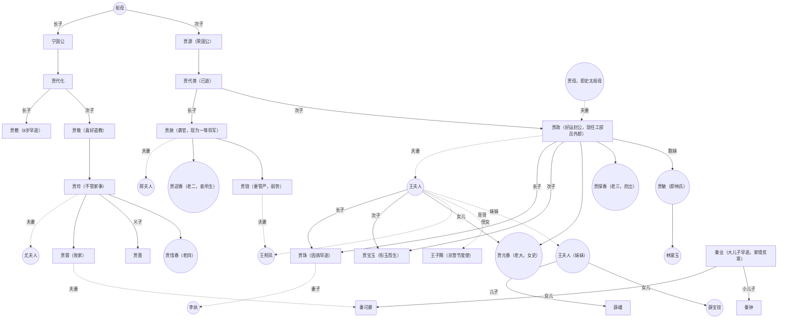

续第二回

这天贾雨村到酒肆，意外遇到做古董贸易的老友**冷子兴**。冷子兴介绍到贾雨村的同姓旁族宁国和荣国贾家今天已经家道中落，外表还能保持光鲜亮丽，内部已经衰落。宁国府和荣国府正好在一条街的东西两侧且相连，府宅占了大半条街。

下面是冷子兴介绍了两家的人物关系，我用关系图来标注：

贾宝玉好女人首饰。贾政便嫌弃他是酒色之徒，但太夫人还疼爱曾孙。冷子兴说他后来一定是酒色之徒，而贾雨村却说他是汇集大仁大恶之气的神人。

### 第三回 贾雨村夤缘复旧职 林黛玉抛父进京都

林如海为贾雨村作了举荐信，把贾雨村举荐到荣国府。荣国府祖母念及林黛玉孤身伴父，也请林黛玉寄居荣国府。贾政礼贤下士，对贾雨村颇有好感，后来替贾雨村谋了个岗位。

林黛玉到了都城，便感觉到此地气派不凡，处处谨言慎行。到了荣国府，祖母贾母（姓史）抱着外孙女哭泣。林黛玉和几个舅妈表姐妹打过招呼，她们见黛玉体弱多病，问到治病。林黛玉回，三岁时曾遇到个癞头和尚要带她出家，父母不肯，和尚便说恐怕她要一生体弱多病了。若要平安健康，除了父母不得见任何外亲。黛玉一家并不信。

随后林黛玉表哥贾琏的妻子，性格火辣的**王熙凤**见了林黛玉。林黛玉的二舅妈，贾政的妻子**王夫人**带着她先是见了林黛玉的大舅妈，贾赦的妻子**邢夫人**；又到了舅舅贾政府上。王夫人告知林黛玉她的二儿子，黛玉的表哥贾宝玉是家里的“混世魔王”，可不要搭理他。

晚间黛玉和几个舅妈、表妹在贾母后院吃了饭，正好遇到了贾宝玉回家。贾宝玉对林黛玉格外亲近，问到可有宝玉？林黛玉说不曾有，引得贾宝玉伤心摔玉。贾母视外孙天生口衔这玉为命根子，极为心疼，便唬骗贾宝玉林黛玉也是有宝玉的，不过是黛玉母亲去世时陪同下葬了。

林黛玉来荣国府带了奶娘**王嬷嬷**和一个随身的小丫头**雪雁**。贾母把自己身边的一个丫头“**鹦哥**”分配给林黛玉，又给分配了几个嬷嬷和丫鬟。贾宝玉的奶娘是**李嬷嬷**，大丫鬟名为**袭人**。袭人本是贾母的婢，贾母甚是喜欢和信任袭人，就把袭人配给贾宝玉做丫鬟。袭人有个痴情之处，眼中只有主子一个，全心全意伺候。

### 第四回 薄命女偏逢薄命郎 葫芦僧乱判葫芦案

第二天，林黛玉和姊妹们到了王夫人处，王夫人正在计议家务。原来，林黛玉的姨妈薛夫人的儿子**薛蟠**仗势欺人打死人命正在受审。审案的人正是贾雨村。贾雨村本要直接派人捉拿薛蟠，案边的一个门子，曾经在葫芦庙住过的，认识贾雨村，拦住了他。门子告诉贾雨村本地有**贾史王薛**四大乡绅是不可得罪之人。门子又介绍到这个人命案：被打死之人是本地一个小乡绅之子名为冯渊，先从人口拐卖贩子处买得一个丫头；不料人口拐卖贩子又悄悄把丫头卖给薛蟠，想赚两边钱跑路而不得。二人先把人口贩子揍个半死，后薛蟠仗势欺人又打死了冯渊。更巧的是，这拐卖的丫头，正是昔日甄士隐唯一的女儿英莲。

贾雨村本想依照法理断案。但门子说到薛家不可得罪，大道理在现实行不得。如果得罪薛家，不但没机会升官进爵，很可能自身难保。门子建议贾雨村表面上遣人捉拿薛蟠，实则谎报薛蟠暴病身亡，让薛家赔偿一千两做葬礼钱就了事。贾雨村就照这个方案执行了。

却说薛蟠是个不懂家庭经营的纨绔子弟。父亲早逝，母亲是贾政的妻子王夫人的妹妹，又有舅舅**王子腾**现任京营节度使。薛蟠的妹妹名为**薛宝钗**，有读书写字的天分，但哥哥不争气，便只做家事为母亲分担。近日，皇帝崇尚诗文礼仪，又碰上京都中生意被害，薛蟠为了送妹妹进京举荐、管理京都生意，收拾东西上京城。起身前就遇到了这个人贩子在卖英莲。

薛蟠带着母亲和妹妹入京，恰好舅舅王子腾升了职调任到京都外，于是三人借住了荣国府，薛蟠受了贾家看管。薛宝钗行为豁达，相比孤高自许的林黛玉，更得下人丫鬟们欢心。

### 第五回 游幻境指迷十二钗 饮仙醪曲演红楼梦

这天，宁府梅花盛开，于是贾珍的妻子尤夫人邀请了贾母和一干夫人饮酒赏花。中间贾宝玉犯困，贾蓉的妻子秦夫人便安排他到自己房间休息。

> 世事洞明皆学问，人情练达即文章。

宝玉睡着，梦见自己到了个人迹罕至的山林中，见到了一个仙姑。仙姑称自己号为“警幻仙姑”，负责“掌管人间风情月债、尘世男女痴怨”，邀请她到自己的“太虚幻境”喝茶饮酒。宝玉求着仙姑带他游览“薄命司”，看到一间房屋用封条封上，封条上写着“金陵十二钗正册”。仙姑说“金陵十二钗正册”只记载各省中十二个最主要的女子，另有次要的女子记录在《金陵十二钗副册》，再次要的记录在《金陵十二钗又副册》。说是女子，实际上只画着景观题了诗，并没有指名道姓是哪个人，贾宝玉一时看不懂参不透这本册子。

> 假作真时真亦假，无为有处有还无。

仙姑知道贾宝玉天分聪颖，怕他参透册子泄露天机，就把他带到了幻境之内，又上来几个仙子。仙子嗔怪警幻仙姑，怎么带来个男儿身浊物到此清净女儿之境。警幻仙姑称自己遇到了宁荣二公之灵，嘱托她引导贾宝玉能戒痴情顽劣、跳出宿命、走上正途。而那“金陵十二钗”之册，其实正是宁荣二家上中下三等女子的记录。随后警幻仙姑请宝玉品仙茶饮仙酒，看得舞女和《红楼梦》十二只曲跳舞。宝玉只觉无趣，警幻感叹“痴儿尚未领悟”。又带宝玉到了一间闺房中，早有一名女子名为**秦可卿**在内。警幻仙姑称将可卿许配给宝玉，秘授宝玉以云雨之事，于是贾宝玉和可卿玩得难解难分。第二日，二人出去游玩，见得虎狼成群，有水鬼拖宝玉下去，弄得宝玉惊醒。门外秦夫人听得宝玉梦话纳闷，原来那“可卿”正是她乳名。

### 第六回 贾宝玉初试云雨情 刘姥姥一进荣国府

宝玉惊醒后，只有袭人察觉宝玉裤子上冷湿。于是贾宝玉把梦中故事说与袭人听，袭人听得又羞又笑。宝玉也喜欢袭人温柔娇媚，袭人也知道贾母把自己许配给宝玉，于是二人偷偷试了一番云雨之事。

京都千里之外，有个小小人家，其实和荣府有些关系。这家姓王，祖上做过一个小京官，结识了王夫人的父亲。因为王夫人家的权势，便允许他沾上亲故，认作侄儿。那个时候只有王夫人和王夫人的哥哥（王熙凤的父亲）在京都，知道有这一桩关系，其余人都不了解。如今小王氏祖上已逝，只有一个儿子名为王成，家道中落后搬出京都生活。最近王成病逝，只留下儿子狗儿。狗儿娶刘氏为妻，又有一子一女，儿子叫板儿，女儿叫青儿。刘氏的母亲便是**刘姥姥**。狗儿一家四口加上刘姥姥就在城外依靠种田过活，生活困窘。

刘姥姥建议狗儿去找荣府王家攀攀关系说不定能求到点好处。狗儿便想了法子，让刘姥姥带着儿子板儿进荣国府前先找陪房周瑞，这人和王成关系不错。周瑞的妻子看在曾经交情，答应帮忙求见王夫人，但也提前警告了现在掌管家务的已经不是王夫人而是王夫人的侄女王熙凤。于是趁着荣国府吃饭时候，刘姥姥随着周瑞家进了荣国府。周瑞妻子先和王熙凤的心腹丫头**平儿**通了气，交代了刘姥姥的来历，先把刘姥姥及板儿安置在客房。后来王熙凤下了楼，刘姥姥终于见了王熙凤。

王熙凤表面上热情地接待了刘姥姥。刘姥姥正要说明来意，王熙凤的侄子贾蓉来到府上，向王熙凤借一个玻璃屏风。刘姥姥说到自己家境艰苦，于是王熙凤且赏了二十两银子，刘姥姥喜出望外。

### 第七回 送宫花贾琏戏熙凤 宴宁府宝玉会秦钟

周瑞妻子送刘姥姥回去后，上来回王夫人话，得知王夫人正在和她妹妹（即薛蟠的母亲薛夫人）聊天，便往里间来，见到薛宝钗。周瑞妻子问到宝钗几日没见出去逛逛，薛宝钗说到自己的病又发作了。这病难治，唯有一个秃头和尚带来个秘方，此药叫做“冷香丸”，只不过药方条件极其苛刻，但确能缓解病症。

周瑞妻子见了王夫人，交代了刘姥姥的事，薛夫人便委托她把自己带来的花分给姐妹们。英莲被薛蟠买下作丫头，换了名“**香菱**“。周瑞妻子便把花依次分给了迎春、探春、惜春姐妹、王熙凤和林黛玉。黛玉彼时正和宝玉玩东西，宝玉帮忙问了花的由来和薛宝钗的近况。黛玉倒嗔了一句”别人挑剩下的花儿才留给了我“。

周瑞的女儿正好寻往贾府遇到母亲，说到她老公（周瑞女婿）前段时间吃酒吃多和人起了纷争，被人告了”来历不明“要被赶出京城，请母亲帮忙解难。原来周瑞的女婿正是冷子兴。

第二日，应贾珍之妻尤夫人和秦可卿邀请，王熙凤和贾宝玉进了宁府。贾蓉带出一个腼腆后生，他是秦可卿的小兄弟，名为”**秦钟**“。宝玉见秦钟人品出众，自卑自己空有富贵不得早结交他；秦钟见宝玉衣着华丽，自卑自己清贫不得结识宝玉。二人几句对话反倒结识起来。宝玉问到秦钟学习情况，原来二人刚好正在停学阶段，于是宝玉邀请秦钟一起到家中私塾读书。

夜晚，尤夫人秦夫人准备叫人送秦钟回家，恰逢叫来的人是**焦大**。焦大这人小的时候曾经救过太爷的命，仗着这份救命之恩在府中豪横怠慢。这晚焦大喝醉了连着贾蓉一起辱骂，贾蓉怒得让人绑了他拖到马圈里去。

### 第八回 比通灵金莺微露意 探宝钗黛玉半含酸

王熙凤和贾宝玉从宁府回家，替秦钟向贾母美言几句，得到贾母欢心。

两日后贾母等去看戏。待到贾母疲惫后，贾宝玉送贾母回家歇息，顺便拜访薛家探病薛宝钗。薛宝钗取下了贾宝玉所戴的美玉，鉴赏其上镌刻有字。宝钗的丫鬟莺儿笑着提到薛宝钗的项圈上也镌刻有字，和宝玉这玉上所写像是一对。于是宝玉也赏起薛宝钗的项圈。二人聊到一半，林黛玉也来探病了。黛玉笑着说自己来的不巧了没交错着时间来。正好是下雪天，三人在薛姨妈家吃茶。贾宝玉的奶妈李嬷嬷拦着宝玉不让他喝酒，但薛姨妈还是热情地助宝玉尽兴喝酒，宝玉酩酊大醉。

李嬷嬷回家换了衣服，让丫头们帮忙盯梢。林黛玉贾宝玉不等李嬷嬷回来就直接和丫头们告辞薛家。宝玉问到自己留着的豆腐皮包子和枫露茶，听丫鬟说到都给李嬷嬷吃了，宝玉怒而摔茶杯，大骂要赶走奶妈李嬷嬷。彼时装睡的袭人赶紧起身安抚宝玉，这才安宁。

次日，宝玉带着秦钟见了贾母，甚是讨贾母欢心。秦钟的父亲**秦业**听闻儿子有在贾家私塾读书的机会，非常喜悦。但是家境贫寒，硬是东拼西凑带了二十四两给秦钟，来到私塾老师**贾代儒**家拜见了。

### 第九回 恋风流情友入家塾 起嫌疑顽童闹学堂

两天后，宝玉和秦钟去私塾上学了，二人关系甚好。私塾中本族子弟人多眼杂，看了宝玉和秦钟人腼腆关系又好，流言闲言遍布校内。薛蟠为了结识更多同龄兄弟也入私塾读书，并不花一分心思在读书上。宝玉和秦钟二人又与两个学生，一作“香怜”，一作“玉爱”关系密切了起来。

这天，老师贾代儒有事不在，让**贾瑞**暂且管理学校。秦钟和香怜到后院楼梯边说悄悄话，被另一个名为“**金荣**”的同学看到。秦钟和香怜先去找贾瑞告金荣的状。原来贾瑞这人是个欺软怕硬之人，他巴结薛蟠而不得，心中暗自抱怨宝玉、秦钟二人不在薛蟠面前提携他，又看到这场纠纷，于是先以公报私批评起香怜。金荣见秦钟二人被批，越发得意，在教室里更造起二人大谣。反倒惹怒了另一个同学**贾蔷**。贾蔷也是宁府正派玄孙，父母早逝，由贾珍抚养，和义兄贾蓉关系很好。但后来为了避免流言，贾珍分了贾蔷一间房间，让他搬出了宁府自己生活。

贾蔷本性聪明而不用心于学问，既有贾珍、贾蓉这层关系，怎能接受贾蓉的小舅子秦钟被欺负？但又想到如果自己也出来闹，得罪了金荣贾瑞，他们和薛蟠关系也挺好，这样可能得罪了薛蟠。于是把宝玉的一个书童名唤“**茗烟**”的叫来，说到金荣欺负秦钟，还添油加醋到把宝玉也牵涉在内。茗烟年轻不谙世事，性情又暴躁，便直接揪住金荣辱骂。贾蔷趁机早离了学校。金荣更怒，要去打宝玉和秦钟。金荣的朋友拿着砚朝茗烟扔去，没砸中，反倒砸到**贾兰**和**贾菌**的座位上，墨水染脏了他们的书籍。贾菌也是荣国府近派的重孙，和贾兰关系甚好，也是淘气不怕人，见状大怒，把自己书包朝金荣朋友那边砸去，也没砸中，书包里的书籍文具散落地上，还把宝玉的茶误伤打碎了。整个校园闹得乱哄哄的，茗烟和几个书童打金荣，贾菌打那个扔砚的学生，还有其他学生在看热闹。贾瑞根本拦不住他们。

学校外，今日护送读书的仆人是李嬷嬷的儿子李贵。李贵等人听到校内动静，赶紧冲进去拦住并喝骂茗烟等书童。贾宝玉和秦钟哭闹着不来读书了，坚决不接受和金荣在一起读书。贾瑞此时怕事情闹大了，硬唬着金荣给秦钟道歉。

### 第十回 金寡妇贪利权受辱 张太医论病细穷源

金荣道歉后回了家，越想越气，认为秦钟是仗着宝玉欺负人。他母亲胡夫人说了他一通，咱们是求着人家得到的念书机会，金荣这才忍气吞声。

却说金荣的姑父名为**贾璜**，他是贾家“玉”字辈嫡派，但远不如宁荣二府富贵。贾璜夫妻时常会到宁荣二府请安，和尤夫人、王熙凤关系较好。这天贾璜的妻子**璜大奶奶（即金氏）**来到嫂子家，听闻了金荣受欺负的事，一时愤怒，要到宁荣家为金荣讨理。璜大奶奶到了宁府，见了尤夫人。尤夫人说到弟妹秦可卿近日生病修养，结果又听了自己弟弟秦钟昨天读书遭事，忧愁更上心头。璜大奶奶听了受吓，不敢再为侄子打抱不平。二人又闲话一会，璜大奶奶回去了。

贾珍刚才请太爷贾敬过后天的寿宴，结果太爷图清净，拒绝别人的拜访和礼物。尤夫人对贾珍说，秦可卿的疾病找了许多大夫看诊，都得不到确定的结论，反倒不断看诊更加剧了病症。贾珍说到冯紫英大夫向他推荐了自己的老师张友士大夫。第二日，张大夫到了府上，见了秦可卿，一把脉就道出病端，写下药方，只说这病尚有三成痊愈可能。

### 第十一回 庆寿辰宁府排家宴 见熙凤贾瑞起淫心

贾敬的寿辰到了。贾珍让贾蓉送了些果品给太爷贾敬，自己和尤夫人在宁府里接见客人，并且叫了一班唱戏人在园子搭台准备唱戏。接着邢夫人、王夫人、王熙凤、贾宝玉都来了。贾珍和尤夫人嗔怪贾母谢绝不赴会，王熙凤先替王夫人回答到贾母身体不适所以谢绝了。王夫人又问到秦可卿病况，王熙凤为秦可卿的病叹息。此时贾蓉回来，回复了贾珍，太爷为贾珍替他拦住了庆生的客人而高兴。尤夫人、尤夫人的母亲、邢夫人、王夫人、王熙凤吃过饭后，准备去园子听戏。王熙凤和贾宝玉先去看望了秦可卿，凤姐和宝玉都为她的病伤心，还是凤姐不忍加剧秦可卿伤感，说到一定多来探病，又撺掇了宝玉和贾蓉去看戏。

凤姐前往园子，突然窜出贾瑞。贾瑞对凤姐有意思，调戏凤姐一番。凤姐知道贾瑞淫心，心想此人确实禽兽，后续定要使手段弄死贾瑞。然后凤姐和尤夫人、邢夫人、王夫人一起看了戏，回了府。后续凤姐也时不时来看望秦可卿，没见秦可卿好转，众人心忧。

到了冬至，贾母又让凤姐去探病秦可卿。秦可卿脸上已瘦削了。二人闲话过后，凤姐出来，和尤夫人谈到提前准备丧事流程了。凤姐回到荣府，见过贾母、王夫人，回到家中，听闻丫鬟告诉他贾瑞又来打听她是否在家，大怒，盘算如何设计整死贾瑞。

### 第十二回 王熙凤毒设相思局 贾天祥正照风月鉴

王熙凤正在和丫鬟说话，正好此时贾瑞又来拜访。凤姐假意殷勤表露爱意，唬得贾瑞上了钩。凤姐让贾瑞半夜到西边穿堂等她。半夜贾瑞钻进贾府，凤姐根本不来，遇到门户被关进退不得，在贾府里挨冻了一夜才回去。贾瑞现在只有祖父贾代儒教养，贾代儒看贾瑞一夜不归，料定他在外面吃酒赌钱、嫖娼宿妓，狠狠罚了功课。

贾瑞遭了这两难，仍然色心不改，以为是凤姐捉弄他。凤姐又叫他夜里到院子里的空屋子等她，然后私下安排了贾蔷、贾蓉在院子内埋伏。贾瑞欲望更加强烈，夜里又溜到贾府，黑灯瞎火时见到贾蓉错认为是凤姐，直接把人抱到炕上要干，突然灯光一亮，被贾蔷抓个现行。贾蔷、贾蓉各诈了贾瑞五十两欠条，又被二人骗到院里被泼一桶尿粪，一身狼狈地才回了家。

贾瑞遭了两次冻，受罚了功课，留了一百两欠条，对凤姐相思不灭，种种因素缠身生了大病，请来各种医生服用各种药房都不见好。后面药房开了人参，贾代儒向着荣府来求，凤姐就拿了些人参残渣敷衍过去。

贾瑞求活命心切，无药不吃。这日来了个跛足道人，取出一面镜子给贾瑞。此镜名为“风月宝鉴”，两面皆可照人，出自太虚幻境空灵殿上，为警幻仙子所制，专治邪思妄动之症。跛足道人告知贾瑞照此镜背面三日可活，但万不可照正面。贾瑞照了背面，见一骷髅立在里面，被惊吓；又看正面，竟是凤姐在里面招手叫他。贾瑞仿佛进了镜子，与凤姐云雨一番又送出来。贾瑞欲望更加强烈，再不看反面骷髅，反复看镜子正面，和凤姐云雨。只是三四次后，贾瑞再想脱出镜子，被镜中人用铁索拉住再不放走。外面的人看贾瑞还拿着镜子照，虽睁着眼，却已没了气。贾代儒夫妇大忸，认定此镜是个祸害，用火来烧。跛足道士正好进来，夺回风月宝鉴，又飘走了。

### 第十三回 秦可卿死封龙禁尉 王熙凤协理宁国府

这年年底，林黛玉父亲林如海身染重病，寄信让黛玉回去。贾母安排了贾琏和黛玉一起回扬州见林如海。

这日夜里，凤姐睡梦中见到秦可卿从外走来告别，又留下心愿。秦可卿对凤姐道：“现在我们家尚且赫赫扬扬，他日若遭了变故，恐怕要树倒猢狲散。今日诸事尚安排妥当，只有两件不妥。一是祖茔没有保留一定钱粮，二是私塾没有保留一定供给。若是他日家族败落，这两项就供不上了。不如早早和家族成员定下规矩，让各家轮流掌管祭祀、供给的钱财。他日真有败退，子孙尚可读书务农，还能保留祭祀。切不可沉溺于暂时的繁华，一时的欢乐。我念和婶子关系亲密，临别留下两句劝。”凤姐惊醒，听人道秦可卿病逝了。

宝玉在梦中听闻秦可卿病逝，坚持半夜受冻也到宁国府。宁国府贾家一众都聚在宁国府哀悼，后来秦家亲属也到宁国府。贾敬听闻长孙媳妇去世，恐自己修炼被尘世耽误，因此不管丧事。贾珍对儿媳妇去世感到巨大悲痛，为她风光大葬，准备极尽奢华。薛蟠说留有极好的神木材质的棺材，贾珍直接用了。贾政劝阻，说此棺材非常人可享用，用上等杉木即可，贾珍不听。

贾珍看儿子官职平平，写在灵幡经榜上不光彩，正不自在。正巧今日大明宫掌宫内相戴权偕人来哀悼，贾珍便向戴权为贾蓉求个官职。戴权提供他一个龙禁尉的官职，让贾珍后续准备一千二百两银子送到他府上。贾珍感激不尽。后续秦可卿葬礼风光不题。

贾珍此时心满意足，但又遇到尤夫人犯了病不能料理家中事务。宝玉向他推荐了王熙凤。贾珍便在邢夫人、王夫人和王熙凤都在场时，请求凤姐帮忙料理宁国府事务一个月。王夫人怕凤姐没有料理过丧事，怕她料理出错惹人笑话。凤姐则喜欢招揽事务、卖弄才干，巴不得有这等事务料理。于是王熙凤接了宁国府的料理事务。

### 第十四回 林如海捐馆扬州城 贾宝玉路谒北静王

宁国府总管**来升**听说宁国府事务委托给凤姐，提前召集了管事人员，说明了凤姐做事风格严苛无私，让大家坚持卖力一个月，不要得罪了凤姐。凤姐一来宁府，先给众人下马威，然后把家事分配得明明白白，把散乱的宁家管理改造得清楚。宁家依旧在操办秦可卿的丧礼，请来诸多佛僧大师做法，置办各种器物。同时荣家的事情依旧进行，更兼近日其他国公也有各种大事。凤姐两头忙活，虽然很累，但能让众人欣赏高看，凤姐极其高兴。

这日宝玉、秦钟正到凤姐处做客。凤姐派去苏州的丫鬟昭儿回来，交待了林黛玉父亲林如海去世的事情。黛玉和贾琏也要在苏州操办后事到年底才能回来。凤姐问询了情况，让昭儿带了些厚衣物又去苏州。

### 第十五回 王凤姐弄权铁槛寺 秦鲸卿得趣馒头庵

到了出殡这日，诸国公诸位子爵都来出席。当中有一位北静郡王**水溶**，年轻俊秀，性情谦和，念及昔日祖父与宁荣二家交情，所以不以王位自称。贾珍听闻北静王到此，携贾赦贾政一起拜访。水溶又问到宝玉，宝玉早知水溶才貌双全为人谦逊，欢喜来见。水溶见宝玉谈吐优雅，向贾政赞扬其子，但又说宝玉如此资质，容易被老太夫人、夫人辈溺爱，容易荒废学业，邀请贾政送宝玉到自己府上读书。水溶又送一串念珠给宝玉。贾政和宝玉谢过。

宁府为秦可卿出殡，出了城门直奔铁槛寺而来。凤姐怕宝玉骑马有闪失，让宝玉和自己同坐一台轿子。秦钟则骑马跟着宝玉的轿子。众人到了一处村庄歇息。宝玉和秦钟在府里荣华富贵，没有见过农庄里的农具和纺车，十分好奇。一位农村丫头为他们演示了使用纺车，宝玉对这不一样的生活充满兴趣。

队伍继续出发，到了铁槛寺，为秦可卿安灵。法事筵席之后，诸位公侯渐渐辞别散去，只剩下凤姐等亲属要做满三日法事才能回去。王夫人想带宝玉回家，宝玉对郊外感到好奇，不肯回去，于是王夫人让凤姐看管好宝玉。

铁槛寺原来是宁荣二公在世时出资修造的，内部设有房间供族人下榻。其他亲属暂且在铁槛寺下榻了。凤姐嫌不方便，便让水月庵的尼姑**净虚**准备了两间房间借宿。这水月庵别名馒头庵，因为这庙里的馒头很有名。水月庵的尼姑僧侣和贾家交情笃厚，恰好水月庵离铁槛寺也很近。今日法事完毕，凤姐带着宝玉、秦钟来到水月庵歇息，净虚带着**智善**、**智能（儿）**二徒弟接客。秦钟、宝玉二人在殿上玩耍，看见智能儿过来了，宝玉就挑逗起秦钟，让智能儿给他们倒杯茶。原来，智能儿也经常在荣府走动，因此和秦钟、宝玉也是好友。随着年纪增长，智能儿和秦钟两人反倒互生情愫、情投意合。宝玉曾看到秦钟在贾母屋里趁着没人搂抱了智能儿，所以也知道这二人有这等关系。

净虚趁着凤姐身边没人，向凤姐请求帮助。净虚当年出家时，有个张施主。张施主的女儿小名**金哥**，被长安府府太爷的小舅子李衙内相中求亲。不想金哥已经和原长安守备的公子有了婚约。两边都不愿意放下婚约。净虚请求凤姐让贾琏修书一封给长安节度**云光**，让云光劝守备放弃婚约。凤姐本不想掺和这事，净虚一句“倒显得贾府没有手段处理这种事情”激将了凤姐。凤姐赌气接下了这个请求。净虚听后大喜，阿谀赞美凤姐。智能儿在洗碗，秦钟压抑不住跑来搂抱着他，二人直接上了炕云雨起来，被宝玉抓个正着。

第二天，宝玉依然不肯回去，秦钟依然念着智能儿，于是宝玉求凤姐再住一日。凤姐想到，多住一日，一来对贾珍做足了人情，二来可以借机处理净虚的委托，三者可以顺遂宝玉的心、讨得贾母欢喜，于是又住一日。凤姐完成了净虚的委托，第二日带着宝玉、秦钟回家。秦钟对智能儿百般不舍，含恨而别。

### 第十六回 贾元春才选凤藻宫 秦鲸卿夭逝黄泉路